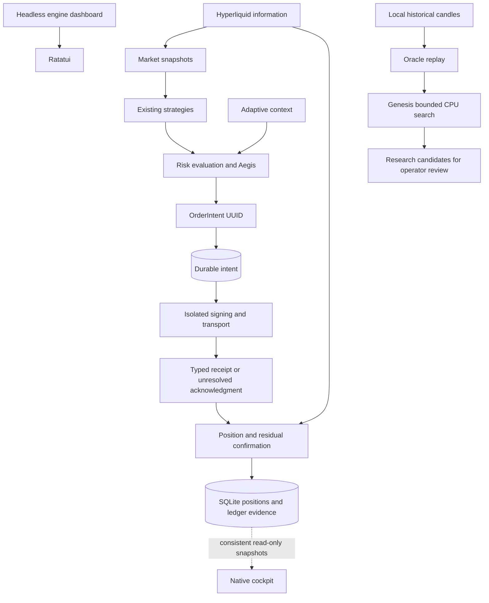

# HYDRA — Project Leviathan architecture

## Executable boundaries

`hydra` dispatches CLI commands and runs the headless engine. The engine owns
strategy evaluation, adaptive context, risk, execution, portfolio management and
SQLite persistence. Ratatui renders a bounded shared dashboard.

The optional `desktop` feature builds `hydra-cockpit`. This native eframe client
reads consistent local SQLite snapshots, provides seven subsystem workspaces and
runs local Oracle/Genesis jobs on a bounded background worker. It has no signing
or order-control interface. Closing the viewer sends no engine lifecycle command.
Explicit first-launch history initialization creates only a new local database;
existing files are preserved.

## Execution and account ownership

`ENABLE_LIVE_TRADING` is authoritative. The CLI `--live` flag asserts that this
configuration is enabled; it cannot override false. The venue adapter also checks
the gate. Dry-run sends no order and is not a simulated exchange.

Each live intent is stored before network submission. New live entries commit
the independent risk reservation and intent together under the same SQLite
transaction and protected connection handle. Its canonical UUID becomes
the exchange client order ID. Submitted, acknowledgment-unknown, resting and
unapplied fills hold new exposure. Pending work for a symbol also prevents another
reduction for that symbol. No blind resend is implemented.

Live history is bound to a canonical account identity. Legacy unbound history
requires explicit audited adoption. A same-user/host OS lock excludes competing
engine/emergency writers across database paths. This is not cross-host locking.
Startup and fresh pre-entry checks require all local and remote net positions to
agree; unknown positions do not become strategy-owned positions automatically.

Confirmed reductions require valid fills and matching exchange residuals.
Residual state and gross diagnostic evidence commit atomically. Net PnL stays
NULL until complete authoritative fee/funding accounting is available. These
unknown outcomes are excluded from learning/compounding and hold new exposure.
Protective close failures are collected per instrument so later instruments are
still processed.

## Durable entry context and narrow recovery

New positions and immutable original risk/learning context commit atomically,
with a unique durable entry-intent identity. Original risk survives stop ratcheting
and restart. Legacy original risk remains unknown; its current stop is never
substituted as original risk. Existing protective exits remain available if
context is missing or malformed.

Recovery can finish the narrow crash window after position persistence but before
journal application when the database account, known fill receipt and fresh
remote position all agree. It does not infer unknown acknowledgments, create
synthetic positions, certify financial settlement or release reservations.

## Persistent risk and ledger

Aegis retains immutable policy, equity high-water marks, latched drawdown breakers
and transactional exposure reservations. It includes pending order exposure and
requires fresh account snapshots. Reservations do not expire on a timer; the
reconciliation API requires explicit proof and a newer snapshot. A narrow runtime bridge now reconciles definite zero-fill rejections and proven
untouched applied entries. It preserves scoped evidence in an immutable batch
archive and atomically replaces the hold with observed exposure. Historical orphan,
ambiguous, reduced and closed entries remain held; new engine entry admission no
longer has a reservation/journal insertion gap. Broader lifecycle work remains.

Only standard Hyperliquid account abstraction (`disabled`) has a supported equity
model. Unknown/default, unified and portfolio-margin modes fail closed. Spot
balances are not added to perp collateral.

The financial ledger uses account/environment-scoped decimal fill and funding
facts, exact-once replay, conflict rejection and bounded provenance. Read-only
history retrieval is paginated with resource/time bounds. Raw closed-PnL
conventions remain unverified, so ingestion is not complete trade settlement.

## Seven logical subsystems

| Head | Implemented foundation | Remaining work |
|---|---|---|
| Hunter | Configured instruments, market snapshots and eligibility checks | Discovery, ranking, rotation and hysteresis |
| Fang | Divergence, momentum/breakout and mean-reversion signals | Shared deterministic planner and explicit strategy ownership |
| Cognition | Expectancy, similarity, regimes, strictness, persisted entry context | Authoritative net outcomes and legacy provenance |
| Aegis | Persistent risk authority, breakers, reservations and scoped terminal-entry reconciliation | Orphan insertion gap and broader lifecycle proof |
| Nexus | Durable intents, typed receipts, decimal ledger and narrow recovery | Broad cloid/fill recovery and complete net settlement |
| Oracle | Deterministic single-instrument candle replay | Full live/simulation parity and richer execution models |
| Genesis | Seeded mutation/crossover and Pareto filtering through Oracle | Out-of-sample validation, resumability and richer scenarios |

Seven head names describe logical boundaries, not independently deployed services.
Activity indicators represent observed database changes or completed research,
never invented subsystem throughput.

## Research contract

Oracle sees completed candles and enters at the next open, applies explicit
fees/slippage and conservative stop/gap handling, and records reproducibility
inputs. It assumes full fills and fixed costs. Funding, queues, partial fills,
liquidation, adaptive behavior, trailing/time-stop parity and portfolio margin are
not modeled.

Genesis searches bounded momentum parameter ranges using actual Oracle runs.
Its seeded algorithm uses deduplication, mutation, crossover and Pareto filtering;
it is not NSGA-II and does not deploy candidates. Inputs are bounded to 32 MiB and
global evaluation/work limits apply. Research configuration omits wallet settings
and engine storage initialization.

See BACKTESTING.md, OPTIMIZATION.md, COCKPIT_GUIDE.md,
HYPERLIQUID_INTEGRATION.md and RISK_MANAGEMENT.md for detailed contracts.

## Exact execution facts — alpha.8

Native filled receipts preserve original decimal quantity, average price and
order identity in `execution_fill_facts`, scoped to the bound mainnet account.
The native production parser validates these against actual signed wire bounds.
Facts and receipt journal status commit together; failed persistence leaves a
submitted hold. `position_precision_state` captures new entry provenance in the
same transaction as position metadata. Aegis ownership uses exact values when
present, while legacy positions retain conservative compatibility checks.

The strategy/core position view still uses floating point. Existing reductions
atomically set current exact quantity to NULL rather than invent an exact
residual; original receipt facts remain available. A recorded unknown or invalid
precision state never falls back to legacy inference. Exact residual proofs and
complete net fee/funding settlement remain separate development work.
