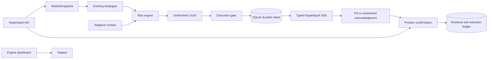

# HYDRA — Project Leviathan architecture

## Current executable boundary

The `hydra` binary dispatches commands through `cli`. The headless engine owns
strategies, risk evaluation, execution, portfolio management, and SQLite persistence.
Ratatui reads a bounded shared dashboard and never signs orders. Closing the TUI
does not own the engine lifecycle. There is no native graphical binary yet.

## Execution foundation

`ENABLE_LIVE_TRADING` is authoritative. `--live` asserts that it is enabled and
cannot enable it independently. The actual Hyperliquid adapter also checks the
configuration gate. Dry-run does not submit orders or write execution intents.

Every live intent is stored before submission. Its canonical UUID maps to the
exchange's 128-bit client order ID. A reused ID is rejected by SQLite. An intent
left submitted by process termination, an ambiguous acknowledgment, or a fill
not yet durably applied blocks new exposure. Pending executions for an instrument
also block another reduction for that instrument. Definite rejections are terminal.
No automatic resend of unresolved orders exists.

The current journal states are `submitted`, `acknowledgment_unknown`, `resting`,
`filled`, `rejected`, and `applied`. Planned/validated/cancellation states and
automatic historical reconciliation remain future work.

Successful reductions require a valid typed fill and matching account-reported
remaining position. Residual and evidence are stored in one transaction. Gross
price PnL is diagnostic; net PnL is NULL until authoritative fees/funding are
available. Such records block new exposure and do not enter `closed_trades`,
adaptive learning, or compounding. Existing historical data is preserved.

## Seven subsystem migration

| Boundary | Existing implementation | Next extraction |
|---|---|---|
| Hunter | Configured instruments and market snapshots | Eligibility/ranking and bounded discovery |
| Fang | Divergence, momentum/breakout, mean reversion | Shared deterministic planner and strategy ownership |
| Cognition | Expectancy, similarity, multi-timeframe regimes, strictness | Persist entry context and fee-adjusted outcomes |
| Aegis | Risk evaluation and exposure limits | Independent authority, durable breakers, pending exposure |
| Nexus | SDK adapter, execution journal, conservative reconciliation | Streams, fill/funding ledger, recovery |
| Oracle | Indicator tests only | Native historical execution simulator |
| Genesis | Not implemented | Seeded optimizer consuming Oracle |

These names describe planned functional boundaries. Seven independent services
have not been implemented. Do not create artificial activity counters for them.

## Storage and ownership

SQLite remains the source for local intent/evidence and historical context, while
exchange positions and fills remain authoritative for execution. The migration
adds tables without rewriting existing ones. SQLite uses FULL synchronous writes.
The connection is mutex-protected; high-volume streaming will need a bounded
writer queue. Signing remains inside the exchange adapter, never in a frontend.

The next process boundary should expose versioned redacted snapshots and commands
over authenticated local IPC. GUI/headless environment separation and account-wide
process ownership must precede enabling a graphical live switch.
