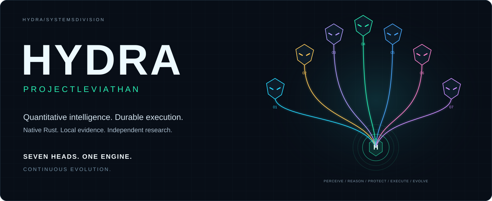
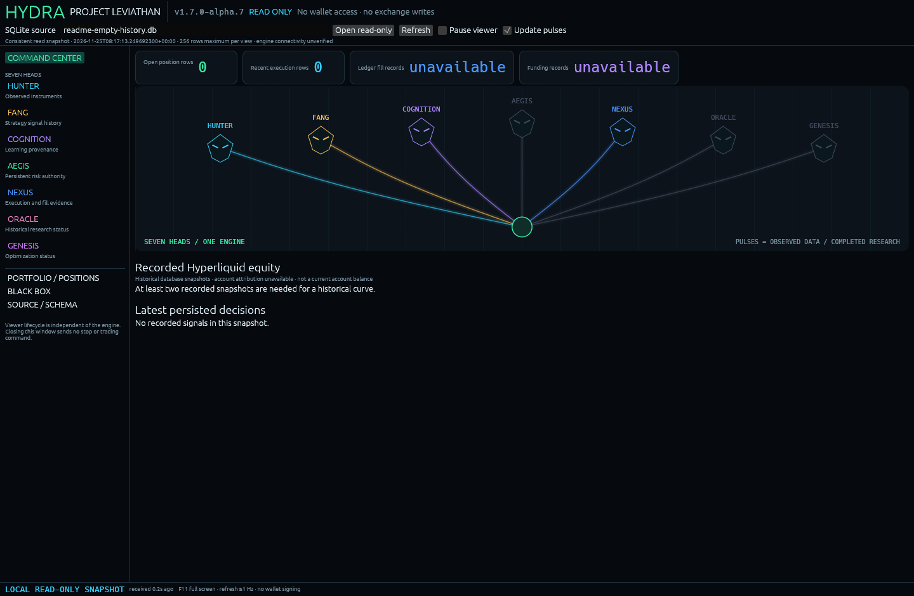
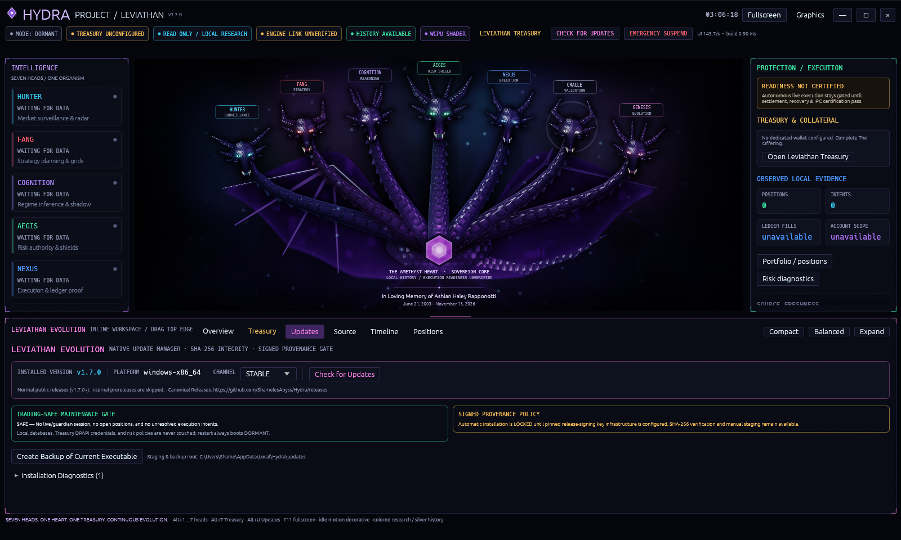
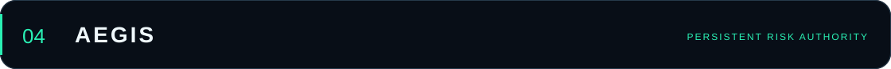
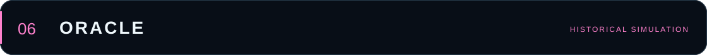
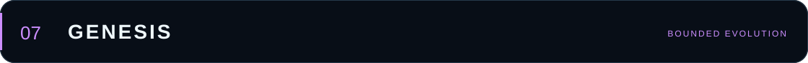
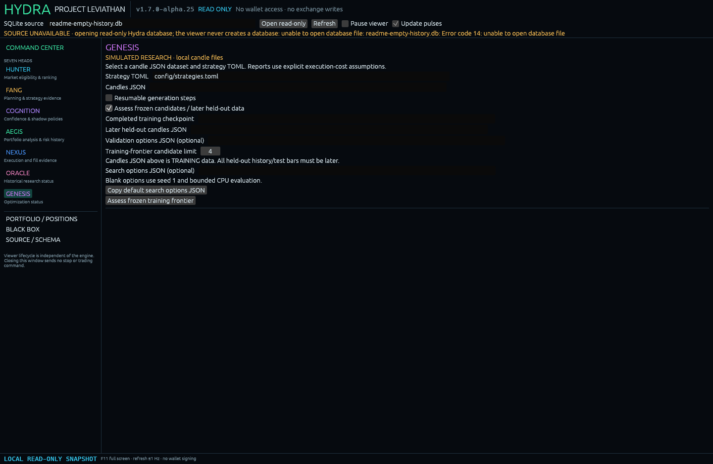

<div align="center">



# Quantitative intelligence, engineered around evidence.

**A native Rust trading engine, living seven-headed WGPU command sanctuary, and research platform for Hyperliquid.**<br>
Obsidian-glass command center · Dedicated OS-protected Treasury · Verified native updates · Explicit uncertainty.

[](https://github.com/ShamelesAbyss/Hydra/releases) [](https://github.com/ShamelesAbyss/Hydra/actions/workflows/verify.yml?query=branch%3Amain) [](TEST_RESULTS.md) [](Cargo.toml) [](LICENSE)

[](#distribution) [](#distribution) [](DEPENDENCY_AUDIT.md)

[**Distribution**](#distribution) · [**Sanctuary**](#cockpit) · [**Treasury**](#treasury) · [**Evolution**](#evolution) · [**Seven Heads**](#seven-heads) · [**Architecture**](#architecture) · [**Quick Start**](#quick-start) · [**Readiness**](#readiness) · [**Atlas**](#atlas)

</div>

> [!IMPORTANT]
> **Engineering prerelease (`v1.7.0-alpha.29`). Unattended live-trading certification is incomplete.**
> Exchange integration exists and live execution defaults strictly disabled (`MODE: DORMANT`, `ENABLE_LIVE_TRADING=false`). Unresolved orders and unknown net settlement block new exposure. No stable release exists yet; all prior alpha releases remain preserved unchanged as historical checkpoints.
>
> **Financial Risk Disclosure:** Cryptocurrency perpetual futures involve substantial risk of total capital loss. Entrust Leviathan only with a separate dedicated wallet funded solely with capital you are fully prepared to lose. No strategy, adaptive model, or backtest guarantees profit.

---

## Project Leviathan

[Contributing & Branch Policy](CONTRIBUTING.md) · [Engineering Handoff](PROJECT_STATUS.md) · [Milestone Matrix](MILESTONE_MATRIX.md) · [Release Notes](RELEASE_NOTES.md)

Hydra unifies market discovery, strategy planning, shadow learning, persistent risk authority, durable execution evidence, historical validation, evolutionary optimization, dedicated wallet vaulting, and native update verification inside **one single-window Rust application**.

Its identity is a living seven-headed cybernetic dragon anchored by a central **Amethyst Heart**: each head represents a distinct quantitative discipline, while one local engine owns durable SQLite evidence. Intents are journaled before submission. Ambiguous acknowledgments stay ambiguous. Missing fees and funding remain explicitly unknown rather than becoming invented profit.

<a id="distribution"></a>
## Releases & Distribution

Compiled executables, portable packages, source archives, release notes and SHA-256 checksums are available through the repository's [GitHub Releases](https://github.com/ShamelesAbyss/Hydra/releases) section.

| Track | Current Status | Contents in GitHub Releases |
| :--- | :--- | :--- |
| **Latest Development Release** | **`v1.7.0-alpha.29`** (engineering prerelease) | Standalone **`HYDRA-Leviathan-Windows-x64.exe`** (WGPU cockpit + Glow fallback), Windows portable ZIP (`HYDRA-Leviathan-Windows-x64.exe`, `hydra-cockpit.exe`, `hydra.exe`), Linux x86_64 headless `tar.gz`, exact-tag source ZIP, and SHA-256 checksum manifests |
| **Latest Stable Release** | *None yet* | Unattended live-trading certification remains in progress (see [Readiness](#readiness)) |
| **Authoritative Development Branch** | [`main`](https://github.com/ShamelesAbyss/Hydra/tree/main) | Continuous Project Awakening development directly on `main` |

- **Windows x64 (Standard Users):** Obtain **`HYDRA-Leviathan-Windows-x64.exe`** from the repository's [GitHub Releases](https://github.com/ShamelesAbyss/Hydra/releases) page, verify its SHA-256 hash against the accompanying `SHA256SUMS.txt` manifest, and double-click to launch. No Rust, Python, PowerShell, CLI arguments, repository clone, or ZIP extraction is required. On a clean Windows profile, Hydra initializes `%LOCALAPPDATA%\Hydra\data\hydra.db` automatically and boots safely into `MODE: DORMANT` with trading disabled.
- **Windows Portable & Linux Headless (Advanced Users):** Portable Windows archives (including the headless/Ratatui `hydra.exe` engine) and verified Ubuntu x86_64 headless `tar.gz` packages are published alongside the standalone executable in [GitHub Releases](https://github.com/ShamelesAbyss/Hydra/releases).
- **Executable Signing Notice:** Current engineering prereleases are **unsigned** Windows executables. macOS and Linux native graphical packages are not currently verified. The [retired 1.6.2 archive](https://github.com/ShamelesAbyss/Hydra/tree/archive/dead-code-hydra-1.6.2) is preserved strictly for historical reference and must never be used for live trading.

---

<a id="cockpit"></a>
## The Living Leviathan Command Sanctuary


*Actual native `--release --features desktop-wgpu` capture on Windows 11 against a clean dormant offline database. No trading activity, exchange session, or profit is fabricated. Idle breathing, blinking, and heartbeat are decorative organism life; colored plasma streams reflect real active local research jobs, silver pips reflect observed local-history deltas, and amber barriers reflect real warnings or holds.*

| Surface | Available Today |
| :--- | :--- |
| **Unified WGPU Native Cockpit** | Custom WGSL volumetric sanctuary shader with automatic `catch_unwind` Glow fallback, living seven-headed cybernetic dragon, dual-peak Amethyst Heart, obsidian-glass rails, read-only SQLite evidence, `Compact`/`Balanced`/`Expand` analytical drawer, and permanent Ashlan memorial |
| **Leviathan Treasury & The Offering** | Dedicated-wallet onboarding altar (`Alt+T` / `--treasury`), Windows DPAPI / Unix `0600` local credential vault, read-only public-address Hyperliquid verification, truthful 12-metric portfolio surface, 6 operational modes (`DORMANT`..`SUSPENDED`), and one-click `EMERGENCY SUSPEND` |
| **Leviathan Evolution (Updates)** | Integrated native update manager (`Alt+U` / `--updates` / `CHECK FOR UPDATES`), GitHub Releases channel filtering (`Stable` / `Development`), SemVer comparison, FIPS 180-4 SHA-256 verification, `secp256k1` signed-manifest provenance checks, staging/backup/rollback, and trading-safe maintenance gating |
| **Research Workspaces** | HUNTER Radar & liquidity map, FANG deterministic arbitration/EMA research, COGNITION shadow evaluation, AEGIS portfolio/correlation diagnostics, ORACLE held-out cost scenarios, and GENESIS resumable checkpoints & frozen-frontier assessment |
| **Terminal (Ratatui) & Headless CLI** | Independent engine runtime, bounded Ratatui TUI, configuration checks, ledger sync, and offline forensic inspectors (`status-history`, `wire-history`, `intent-evidence`) |

<details>
<summary>View historical alpha.9 baseline cockpit capture (comparison)</summary>

<br>



*Preserved alpha.9 baseline capture demonstrating the architectural evolution into the unified WGPU Leviathan sanctuary.*

</details>

---

<a id="treasury"></a>
## Leviathan Treasury & The Offering


*Actual native capture of **LEVIATHAN TREASURY** and **THE OFFERING** inside the unified command window (`--treasury`).*

- **Dedicated Trading Wallet Only:** Operators must create and fund a **separate dedicated cryptocurrency wallet** solely for Hydra and never connect their primary personal wallet. Seed phrases are never requested.
- **OS-Protected Local Vault:** Private signing keys are encrypted locally via Windows DPAPI (`CryptProtectData`, current OS user scope) or strict Unix `0700`/`0600` storage, held in zeroizing memory buffers (`SecretString`), masked in UI inputs, and never transmitted to AI services, logs, telemetry, or developers.
- **Genuine Validation & No Withdrawals:** Verification queries Hyperliquid `/info` using **only the public address** (validating signer/agent role, standard perp `disabled` abstraction mode, collateral, and margin). Automatic withdrawals and arbitrary transfers are permanently absent.
- **Operational Modes & Emergency Suspend:** Supports `DORMANT`, `OBSERVATION`, `SIMULATION`, gated `AWAKENED` (locked until full live certification passes), `GUARDIAN`, and persistent `SUSPENDED` via a prominent one-click **`EMERGENCY SUSPEND`** control.

---

<a id="evolution"></a>
## Leviathan Evolution — Native Update Manager



*Actual native capture of **LEVIATHAN EVOLUTION** (`--updates` / `Alt+U` / top-bar **`CHECK FOR UPDATES`** button).*

- **Truthful Channel & SemVer Resolution:** Queries the official GitHub Releases API (`Development` and `Stable` channels), skips drafts, selects the exact platform/architecture artifact, and never misuses `/releases/latest` to retrieve prereleases.
- **Integrity & Cryptographic Provenance:** Streams downloads with live progress and cancellation, verifies FIPS 180-4 SHA-256 digests against the release's `SHA256SUMS.txt` manifest, and enforces `secp256k1` ECDSA signed-manifest verification. **Automatic installation stays strictly locked** until pinned release-signing key infrastructure is configured.
- **Trading-Safe Maintenance Gate & Rollback:** Refuses to apply updates or restart whenever `AWAKENED`/`GUARDIAN` mode is active, open positions exist, or execution intents remain unresolved. Creates SHA-256-verified backups before replacement, preserves `%LOCALAPPDATA%\Hydra\data\` and Treasury credentials untouched, and never auto-resumes live trading after restart.

---

<a id="seven-heads"></a>
## Seven Heads. Distinct Responsibilities.

[01 Hunter](#hunter) · [02 Fang](#fang) · [03 Cognition](#cognition) · [04 Aegis](#aegis) · [05 Nexus](#nexus) · [06 Oracle](#oracle) · [07 Genesis](#genesis)

These seven heads represent logical subsystem boundaries inside one native Rust application. A visible head reflects its structured role and real local evidence — never a claim that every planned live capability is certified.

<a id="hunter"></a>


**Observe the field.** Evaluates configured markets, candle inputs, spread/liquidity filters, and watchlist hysteresis through CLI and the native Radar workspace. [HUNTER guide](HUNTER.md).


*Implemented: read-only public Hyperliquid perpetual market acquisition (`metaAndAssetCtxs`) with portfolio-aware diversification ranking, plus offline approved-market eligibility, liquidity/cost/directionality ranking, and watchlist hysteresis inside the native Radar. Next: WebSocket streaming resilience and guarded planner-connected rotation.*

<a id="fang"></a>


**Turn context into bounded intent.** Preserves divergence, momentum/breakout, and mean-reversion strategies alongside offline deterministic arbitration, ownership checks, exact external notional budgets, a basic EMA Anchor research kernel, and a **Bounded Deterministic Grid Planner** enforcing strict level limits (`1..=20`), checked-Decimal cumulative exposure caps, and an anti-Martingale multiplier ceiling (`<= 1.5x`). [Analytics guide](ANALYTICS.md).

*Next: shared deterministic live/replay planner integration and multi-strategy net-position ownership.*

<a id="cognition"></a>


**Remember with provenance.** Provides source-separated strategy/regime attribution, recency-weighted statistics, effective sample counts, strictly prior-outcome shadow-policy evaluation, **zero-lookahead causal market-regime inference** (`TrendingUp`, `TrendingDown`, `MeanRevertingRange`, `HighVolatilityTurbulent`), and durable original entry-risk persistence across restarts. Unknown net outcomes remain excluded from learning and compounding. [Method & limits](ANALYTICS.md#cognition--strict-prior-outcome-shadow-evaluation).


*Capture uses the explicitly labelled [synthetic UI fixture](docs/assets/cognition-synthetic-render-fixture.json) solely to demonstrate rendering — not live returns or profitability evidence.*

<a id="aegis"></a>


**Protect the boundary.** Independent risk authority enforcing persistent equity high-water marks, drawdown breakers with explicit audited rearm, immutable risk policies, transactional pending-exposure reservations, scoped terminal-entry reconciliation, offline portfolio concentration/correlation diagnostics, and a **checked-Decimal liquidation-distance & multi-shock margin stress matrix** (`-5%` to `-35%` simultaneous adverse shocks). [Risk management](RISK_MANAGEMENT.md).

*Only explicitly standard Hyperliquid account abstraction (`disabled`) is supported for valuation. Unknown, unified, and portfolio-margin modes fail closed. Next: native protective exchange orders and full live margin qualification.*

<a id="nexus"></a>


**Commit facts before taking the next step.** Journals durable UUID/cloid intents atomically with risk reservations, coordinates durable per-signer nonces across processes, retains pre-signing unsigned MessagePack actions and signing preparation metadata (never storing keys or signatures), validates exact native fill/residual acknowledgments, and provides read-only offline forensic inspectors (`status-history`, `wire-history`, `intent-evidence`). [Hyperliquid integration](HYPERLIQUID_INTEGRATION.md).

*Next: complete round-trip fee/funding net settlement, broader cloid/fill stream recovery, and authenticated control IPC.*

<a id="oracle"></a>


**Make the model explicit.** Deterministic single-instrument candle replay with next-bar entries, two-leg fees/slippage, conservative stop-first handling, adverse stop-gap pricing, rolling disjoint held-out validation across explicit cost scenarios, and **historical dataset integrity & FIPS 180-4 SHA-256 provenance auditing** (detecting timestamp reversals, interval gaps, OHLC inversions, and return spikes). [Simulation contract](BACKTESTING.md).


*Model limits: full fills and fixed costs; no funding, order-book queue, partial-fill, latency, or portfolio-margin simulation yet.*

<a id="genesis"></a>


**Search, measure, propose.** Seeded CPU evolutionary parameter search over Oracle with mutation, crossover, deduplication, return/drawdown/fee Pareto filtering, immutable resumable generation checkpoints, and strictly later frozen-frontier held-out assessment. [Optimization contract](OPTIMIZATION.md).



*Research proposals never deploy automatically to live trading.*

---

<a id="architecture"></a>
## Architecture & Execution Pipeline


| Safety Invariant | Implemented Behavior |
| :--- | :--- |
| **Live Authorization** | `ENABLE_LIVE_TRADING` is authoritative; `--live` cannot override `false`; cockpit boots `DORMANT` |
| **Atomic Admission** | Risk reservation and durable execution intent commit together in one SQLite `IMMEDIATE` transaction |
| **Explicit Uncertainty** | Ambiguous acknowledgments and unknown net settlement preserve evidence and block new exposure |
| **Account Ownership** | Persistent database account binding plus OS file locks prevent conflicting local controllers |
| **Credential Isolation** | Private signing keys stay under OS DPAPI / `0600` local protection; zero key logging or exfiltration |
| **No Withdrawals** | Automatic withdrawals and arbitrary wallet transfers are structurally absent |

[Architecture](ARCHITECTURE.md) · [Hyperliquid Integration](HYPERLIQUID_INTEGRATION.md) · [Risk Management](RISK_MANAGEMENT.md)

---

<a id="quick-start"></a>
## Installation & Local Quick Start

### Windows Native Application (`HYDRA-Leviathan-Windows-x64.exe`)

1. Open the repository's [GitHub Releases](https://github.com/ShamelesAbyss/Hydra/releases) section and select the newest development release (`v1.7.0-alpha.29`).
2. Download **`HYDRA-Leviathan-Windows-x64.exe`** and the release's **`SHA256SUMS.txt`** manifest.
3. Verify the executable integrity before launching:
   ```powershell
   Get-FileHash .\HYDRA-Leviathan-Windows-x64.exe -Algorithm SHA256
   ```
4. **Double-click `HYDRA-Leviathan-Windows-x64.exe`** to launch directly into the living seven-headed WGPU sanctuary (Windows SmartScreen may display an unsigned-binary notice).
   - Optional CLI compatibility flags: `--renderer glow` (OpenGL fallback), `--renderer software` (CPU WGPU fallback), `--fullscreen`, `--treasury`, `--updates`.
   - Startup logs and crash diagnostics are written to `%LOCALAPPDATA%\Hydra\logs\`.

### Linux x86_64 Headless Engine & CLI

Obtain the Linux package and checksum manifest from [GitHub Releases](https://github.com/ShamelesAbyss/Hydra/releases), verify, and extract:

```sh
sha256sum --check hydra-1.7.0-alpha.29-linux-SHA256SUMS.txt
mkdir hydra-alpha29 && tar -xzf hydra-1.7.0-alpha.29-x86_64-unknown-linux-gnu.tar.gz -C hydra-alpha29
cd hydra-alpha29
./hydra --version
./hydra --no-banner config-check
```

### Build From Source (`main`)

Requires Rust **1.94 or newer** (Windows MSVC is the verified native desktop target):

```sh
git clone --branch main https://github.com/ShamelesAbyss/Hydra.git
cd Hydra
cargo build --locked --release --bin hydra
cargo build --locked --release --features desktop-wgpu --bin hydra-cockpit
cargo test --locked --features desktop-wgpu --all-targets
cargo fmt --check
cargo clippy --locked --all-targets
```

### Local Offline Research & Read-Only Diagnostics

No wallet credentials or exchange connectivity are required for offline telemetry, history inspection, or Oracle/Genesis research:

```powershell
.\hydra.exe init-history --db data/hydra.db
.\hydra.exe telemetry --db data/hydra.db --limit 100
.\hydra.exe --config config/strategies.toml backtest --candles historical-candles.json
.\hydra.exe --config config/strategies.toml optimize --candles historical-candles.json
```

Environment templates live in [`.env.example`](.env.example) and strategy parameters in [`config/strategies.toml`](config/strategies.toml). Keep secrets strictly outside version control.

---

<a id="readiness"></a>
## Development Status, Verification & Readiness

| Verification Gate | Current Verified State |
| :--- | :--- |
| **Offline Regression Suite** | **462 passing offline tests** (`cargo test --locked --features desktop-wgpu --all-targets`), covering Leviathan Evolution SHA-256/SemVer/`secp256k1` provenance, HUNTER loopback public acquisition, FANG bounded anti-Martingale grids, COGNITION causal regime inference, AEGIS margin stress, and ORACLE dataset integrity |
| **Renderer & Fallback** | Verified native Windows 11 WGPU shader rendering (`--features desktop-wgpu`) plus Glow compatibility build (`--features desktop`) and `catch_unwind` fallback |
| **Formatting, Clippy & Policy** | `cargo fmt --check`, `cargo clippy --locked --all-targets`, memorial verification, and automated GitHub compliance check pass |
| **Dependency Audit** | `cargo audit` passes with **0 vulnerability entries** and 1 known Chrono maintenance warning (zero advisory ignores) |
| **Signing Conformance** | 8 offline cross-language fixtures verified against published official Hyperliquid Python SDK constants |
| **Live-Trading Certification** | **Not certified.** No real exchange orders, credential probes, or transfers were executed during development; unattended `AWAKENED` mode remains locked |

Open certification blockers tracked transparently in [`MILESTONE_MATRIX.md`](MILESTONE_MATRIX.md): complete round-trip fee/funding net settlement, external deposit/withdrawal cash-flow reconciliation, full WebSocket stream/restart recovery, authenticated local control IPC, external watchdog supervision, and release-signing key infrastructure.

---

<a id="atlas"></a>
## Engineering Atlas

| Operate & Verify | Architecture & Research |
| :--- | :--- |
| [Project Status & Handoff](PROJECT_STATUS.md) | [System Architecture](ARCHITECTURE.md) |
| [Release Notes](RELEASE_NOTES.md) | [Implementation Plan](IMPLEMENTATION_PLAN.md) |
| [Changelog](CHANGELOG.md) | [Milestone Completion Matrix](MILESTONE_MATRIX.md) |
| [Test Results](TEST_RESULTS.md) | [Capability Ledger](FEATURE_PARITY.md) |
| [Cockpit Guide](COCKPIT_GUIDE.md) | [Leviathan Visual Campaign](VISUAL_CAMPAIGN.md) |
| [Hyperliquid Integration](HYPERLIQUID_INTEGRATION.md) | [HUNTER Radar Guide](HUNTER.md) |
| [Risk Management (AEGIS)](RISK_MANAGEMENT.md) | [Offline Analytics (FANG / COGNITION / AEGIS)](ANALYTICS.md) |
| [Dependency Audit](DEPENDENCY_AUDIT.md) | [ORACLE Simulation Contract](BACKTESTING.md) |
| [Contributing & Branch Policy](CONTRIBUTING.md) | [GENESIS Optimization Contract](OPTIMIZATION.md) |
| [Engineering Guidance](AGENTS.md) | [MIT License](LICENSE) |

---

<div align="center">

**SEVEN HEADS. ONE HEART. ONE TREASURY. CONTINUOUS EVOLUTION.**

Native Rust · Durable Evidence · Deliberate Execution

[GitHub Releases](https://github.com/ShamelesAbyss/Hydra/releases) · [Authoritative `main`](https://github.com/ShamelesAbyss/Hydra/tree/main) · [Issues](https://github.com/ShamelesAbyss/Hydra/issues)

</div>

---

### In Loving Memory of Ashlan Haley Rapponotti

*June 21, 2003 – November 13, 2026*

For the beautiful woman who listened to my passions, believed in me, and made my world a happier place simply by being part of it.

Every creation, every discovery, and every milestone reached carries a piece of my heart dedicated to you.

**Forever loved. Forever missed. Forever remembered.** 💜
