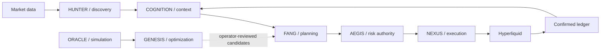

# HYDRA — PROJECT LEVIATHAN

**SEVEN HEADS. ONE ENGINE.**

A native Rust, local-first Hyperliquid trading engine evolving toward a complete
Windows quantitative command center. Existing strategies, statistical learning,
SQLite history, Ratatui monitoring and headless operation remain at its core.

> **1.7.0-alpha.1 · execution foundation · prerelease**
>
> This is a verified offline engineering checkpoint, **not a stable live-trading
> release**. Mainnet integration remains present and defaults disabled. Automatic
> account recovery and authoritative net PnL are incomplete; reductions awaiting
> fees/funding block new exposure. The native desktop GUI is not implemented yet.
> Dependency advisories remain unresolved. See [project status](PROJECT_STATUS.md).

## Start here

- [Download prerelease builds](https://github.com/ShamelesAbyss/Hydra/releases)
- [Current status and exact next steps](PROJECT_STATUS.md)
- [Execution audit](HYDRA_AUDIT.md) · [test evidence](TEST_RESULTS.md)
- [Architecture](ARCHITECTURE.md) · [implementation sequence](IMPLEMENTATION_PLAN.md)
- [Passivbot research](PASSIVBOT_AUDIT.md) · [capability ledger](FEATURE_PARITY.md)

## What this checkpoint implements

| Execution concern | Current behavior |
|---|---|
| Live authorization | `ENABLE_LIVE_TRADING` is authoritative; `--live` cannot override false |
| Intent identity | Canonical UUID stored before network submission and sent as exchange cloid |
| Ambiguous response | Persistent unresolved state; no blind retry or guessed fill |
| Fill parsing | Actual SDK enums and validated quantity/price |
| Position reduction | Valid fill plus matching exchange residual, written atomically |
| Rejected/dry-run close | Position records remain open |
| Realized accounting | Gross reduction evidence retained; unknown net PnL excluded from learning |
| Restart mismatch | Refuse mismatched state; never invent zero-PnL trades |
| Metadata/slippage | Instrument size precision required; bounded, directionally rounded IOC prices |
| Database failure | Critical position read failures propagate instead of appearing empty |

The added offline fault-injection suite covers these contracts. Existing learning,
indicator and terminal tests remain. Passing tests do not establish profitability
or certify an account for live operation.

## The seven heads



This is the target architecture. Hunter discovery, shared Fang planning,
independent Aegis authority, Oracle and Genesis remain scheduled work.
Existing Cognition components include rolling expectancy, historical similarity,
multi-timeframe regimes, adaptive strictness and bounded exploration.

## Windows portable build

Extract the release ZIP into a writable folder. Keep its `config` directory beside
`hydra.exe`. Open a terminal in that folder and run:

```powershell
.\hydra.exe --version
.\hydra.exe --help
.\hydra.exe --no-banner config-check
```

The executable is unsigned. Compare its ZIP SHA-256 with the release checksum.
This checkpoint is a terminal/headless executable, not a graphical application.
No installer or code-signing claim is made. Build artifacts contain no credentials,
databases or personal trading records.

## Build from source

```powershell
cargo build --locked --release
cargo test --locked --all-targets
cargo fmt --check
cargo clippy --locked --all-targets
```

Rust and the Windows MSVC C/C++ build tools are needed to compile; downloaded
portable builds do not require a Rust installation. SQLite is bundled. Linux
build/test/package jobs are provided in CI; consult their actual result before
assuming a published artifact was verified on Linux.

## Execution modes and configuration

The default mode is **dry-run**. Dry-run evaluates signals and risk without
submitting exchange orders; it is not a paper-fill simulator. Historical replay,
paper accounting and backtesting are future independent environments.

The application loads environment settings (including an optional local `.env`)
and the TOML strategy file. `--config` selects an alternative preset.
See `.env.example` for variable names. Keep credentials local and untracked.

```text
ENABLE_LIVE_TRADING=false
MAX_SLIPPAGE_BPS=30
SHUTDOWN_MODE=keep_open
```

```powershell
.\hydra.exe run --symbols ETH,BTC --no-tui
.\hydra.exe run --symbols ETH,BTC
```

Run these only in the intended environment. A previously configured `.env` may
enable live mode: review it first. Ratatui is the default; `--no-tui` uses logs.

### Mainnet mechanism retained

The existing integration uses `HYPERLIQUID_PRIVATE_KEY` and optional
`HYPERLIQUID_ACCOUNT_ADDRESS`, with `ENABLE_LIVE_TRADING=true` as the configuration
gate. `--live` only asserts the gate. Funding alone never enables execution.
Dedicated API-agent account identity verification and secure Windows credential
storage remain pending. **Do not use this alpha as an unattended live upgrade.**
No mainnet orders were placed to validate this checkpoint.

### Stops and recovery

`stop` writes the local stop flag. `SHUTDOWN_MODE=keep_open` leaves exchange
positions intact; `reduce` and `flatten` require confirmed fills and residuals.
`emergency-flatten --confirm` requires live configuration, otherwise it returns an
error without changing positions. It currently manages locally known positions,
not every possible unknown account position or resting order.

`recover` compares current local positions to exchange positions. It refuses
unknown/missing/mismatched positions and never invents PnL. It does **not** yet
replay fill history or clear unresolved journal records. Do not manually erase
journal rows to bypass an unresolved-state block.

## Strategies and learning

Preserved strategies: RSI divergence, momentum/EMA breakout, Bollinger/RSI mean
reversion. Configurable trend/regime filters, ATR stops, chandelier protection,
cooldowns, expectancy and contextual similarity remain present. Settings describe
research choices, not validated profitability. Multiple live strategies cannot
open separate local positions on an already-owned instrument in this checkpoint.

Learning reads existing history; new confirmed reductions with unknown fees or
funding are quarantined. Historical estimated records are not retrospectively
certified as authoritative.

## Limits and troubleshooting

| Message or symptom | Meaning / action |
|---|---|
| `--live requires ENABLE_LIVE_TRADING=true` | CLI cannot bypass disabled configuration |
| `account execution/accounting unresolved` | Preserve evidence; account/fill reconciliation must be completed |
| `prior order unresolved` | A previous write may have happened; do not resend blindly |
| `metadata unavailable` | Exchange precision could not be verified; do not guess it |
| `remote residual disagrees` | Partial/external activity or stale account state needs reconciliation |
| No GUI window | This release is terminal/headless only |

Current exclusions and limitations are recorded in [the audit](HYDRA_AUDIT.md).
Ethereum/Uniswap is not registered as an active adapter. No mandatory cloud,
subscription, Electron or Python runtime is introduced.

## Development and licensing

Each verified milestone is committed, pushed, tagged and released with test and
handoff documents. Incomplete features remain prerelease. The original 1.6.2 README
is preserved as [historical documentation](docs/LEGACY_README_1.6.2.md), not current
operating guidance. Hydra retains its [MIT license](LICENSE). Passivbot is an
isolated research reference under the Unlicense; no code is copied in this milestone.
