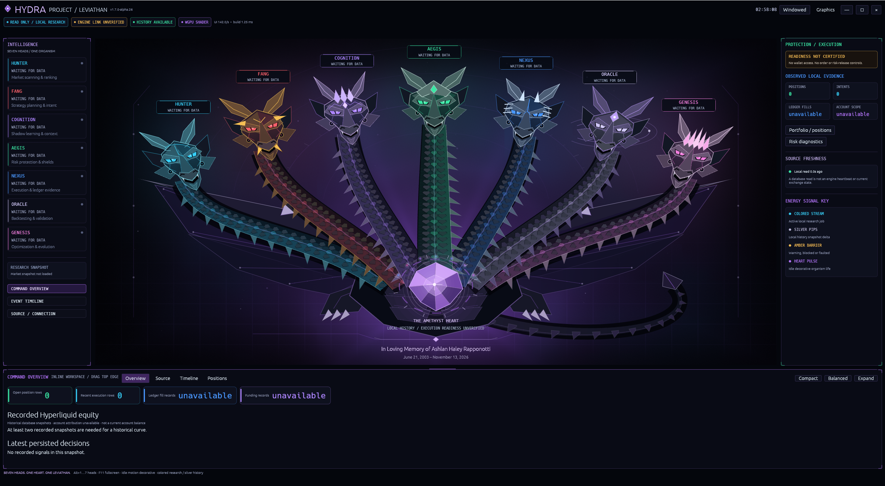
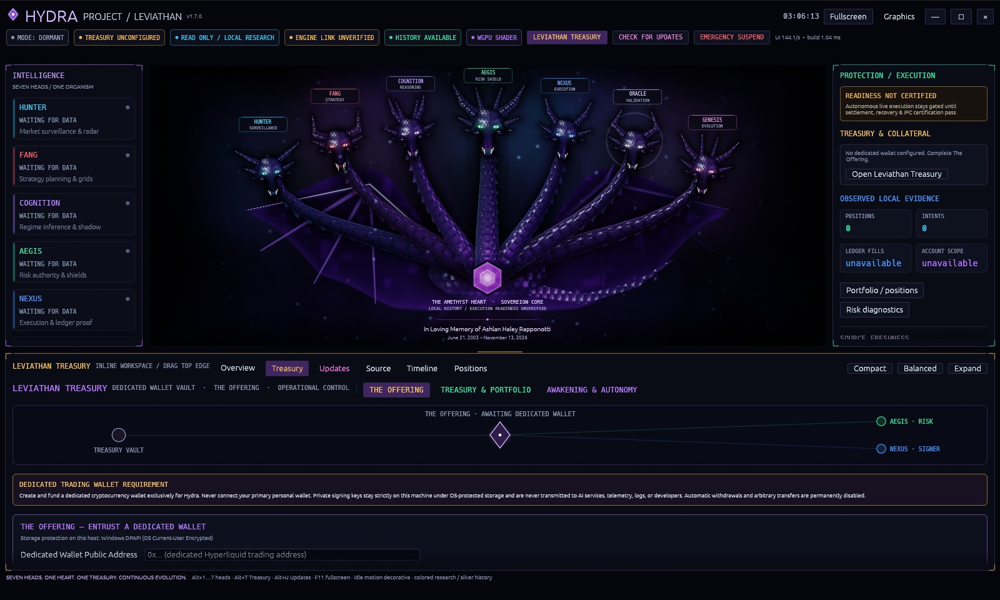
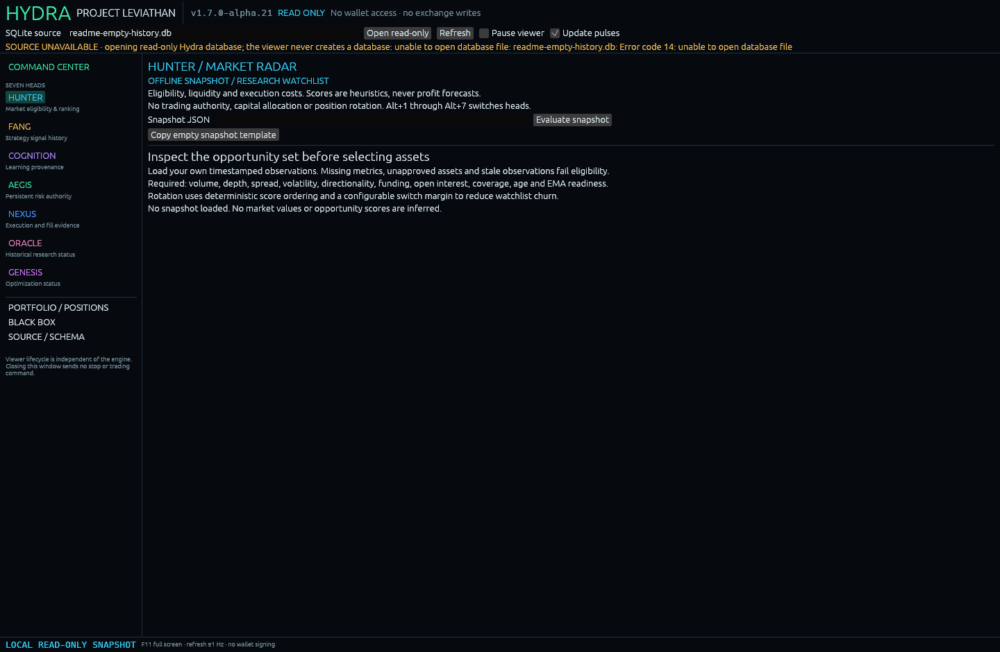
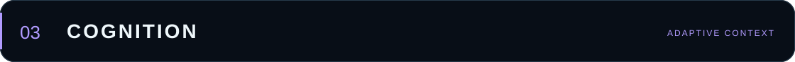
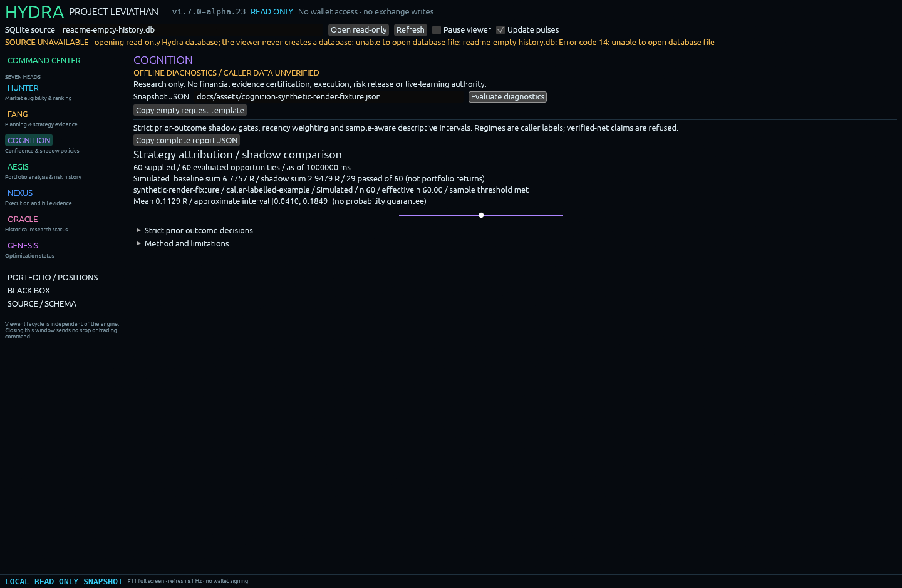
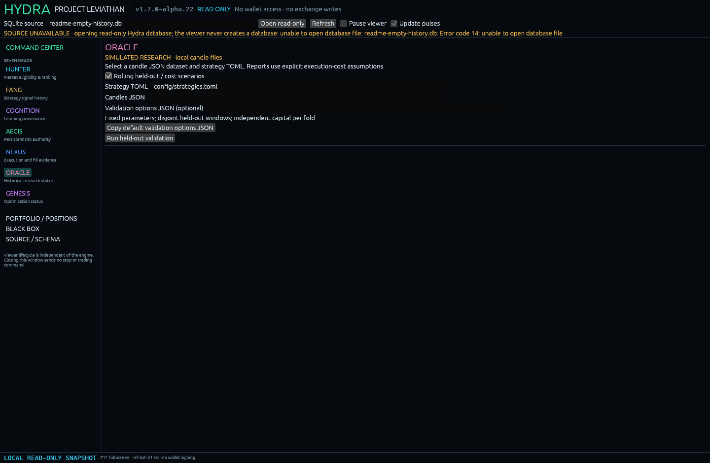
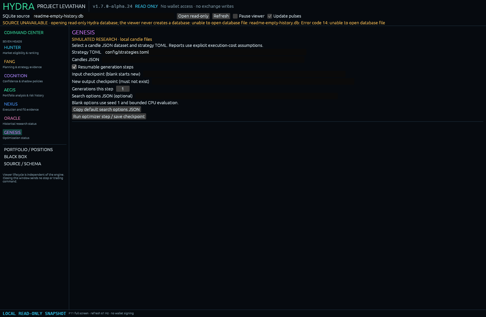
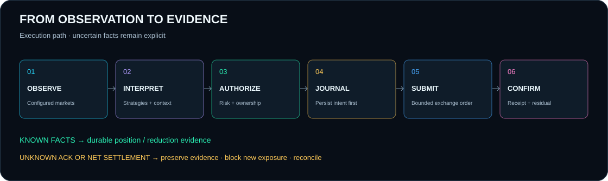

<div align="center">


# Quantitative intelligence, engineered around evidence.

**A native Rust trading engine and research command center for Hyperliquid.**<br>
Seven coordinated disciplines. Local persistence. Explicit uncertainty. Continuous evolution.

 [](https://github.com/ShamelesAbyss/Hydra/actions/workflows/verify.yml?query=branch%3Amain) [](TEST_RESULTS.md) [](https://github.com/ShamelesAbyss/Hydra/blob/v1.7.0-alpha.27/Cargo.toml) [](LICENSE)

[](https://github.com/ShamelesAbyss/Hydra/blob/v1.7.0-alpha.27/DEPENDENCY_AUDIT.md)

### Current development release: `v1.7.0-alpha.27`

**Latest stable release:** None yet (engineering prerelease only). Release notes and compiled artifacts are maintained exclusively in the repository’s Releases section.

*Double-click `HYDRA-Leviathan-Windows-x64.exe` directly on Windows 10/11 — no Rust, Python, PowerShell, CLI arguments, repository clone, or ZIP extraction required. Defaults safely to `DORMANT` with trading disabled.*

[**Distribution**](#distribution) · [**Cockpit**](#cockpit) · [**Seven heads**](#seven-heads) · [**Architecture**](#architecture) · [**Quick start**](#quick-start) · [**Readiness**](#readiness) · [**Roadmap**](#roadmap)

</div>

> [!IMPORTANT]
> **Engineering prerelease. Live-trading readiness is incomplete.** Exchange integration exists and live execution defaults disabled. Unresolved orders and unknown net settlement block new exposure. **v1.7.0-alpha.27** passes **451 offline tests** (`--features desktop-wgpu --all-targets`) and a dependency audit with zero vulnerability entries and one Chrono maintenance warning. Alpha.27 ships the standalone double-clickable Windows graphical executable **`HYDRA-Leviathan-Windows-x64.exe`**, clean-profile startup diagnostics, crash-proof WGPU→Glow fallback, the living seven-headed WGPU Leviathan cockpit, **LEVIATHAN TREASURY**, and **THE OFFERING**. No stable release exists yet; prior alpha releases remain preserved unchanged as historical checkpoints.

## Project Leviathan

[Contributing and branch policy](CONTRIBUTING.md) · [Current engineering handoff](PROJECT_STATUS.md)

Hydra brings market observation, strategy, adaptive context, risk, execution and research into one local quantitative workspace. Its identity is a seven-headed organism: each head has a distinct responsibility, while one engine owns the trading lifecycle and its durable evidence.

The design puts recoverable facts at the center. Intents are journaled before submission. Ambiguous acknowledgments stay ambiguous. Confirmed reductions preserve the exchange residual. Missing fees and funding remain unknown rather than becoming invented profit.

The native cockpit makes that evidence visible. Oracle replays historical candles; Genesis searches bounded parameter spaces using those simulations. Research runs independently of signing and proposes candidates for review.

### Know which Hydra you are looking at

| Track | What it contains | Where to go |
| :--- | :--- | :--- |
| **Windows native application** | **v1.7.0-alpha.27** — standalone `HYDRA-Leviathan-Windows-x64.exe` (WGPU cockpit + Glow fallback + Treasury/Offering) | Repository Releases section |
| **Latest development release** | **v1.7.0-alpha.27** — full release notes, portable ZIP, Linux CLI, source ZIP, SHA-256 checksums; **451 offline tests** | Repository Releases section |
| **Latest stable release** | None yet — unattended live trading certification remains in progress | Repository Releases section |
| **Authoritative main** | Continuing Project Awakening development directly on `main` | [Browse main](https://github.com/ShamelesAbyss/Hydra/tree/main) |

Project Leviathan is Hydra. `main` contains the authoritative implementation and all continuing development. The [retired 1.6.2 archive](https://github.com/ShamelesAbyss/Hydra/tree/archive/dead-code-hydra-1.6.2) exists only for historical preservation and must not be used for live trading. Promotion to main does not establish stable-live readiness.

<a id="cockpit"></a>
## A native command center


*Actual local rendering of the alpha.9 native interface (historical overview capture). Empty local history, initialized offline: no account, exchange session, performance or trading activity is implied. Zero row counts and unavailable ledger tables are shown as observed. The documentation capture uses the real eframe application; no UI mockup or generated trading data is shown.*

The obsidian interface uses cyan, amber, violet, emerald, blue, rose and orchid to distinguish its seven heads. Recorded database changes drive telemetry pulses. Missing data is shown explicitly.

| Surface | Available today |
| :--- | :--- |
| **Native cockpit** | Read-only SQLite views, seven subsystem selectors, positions, execution evidence, risk state, source/schema diagnostics, refresh and pause |
| **Research workspaces** | HUNTER snapshot ranking and liquidity map; local candle/config/options inputs; one background job; actual Oracle equity reports and Genesis Pareto results; JSON export by copy |
| **Terminal dashboard** | Ratatui monitoring with bounded buffers, alongside headless operation |
| **CLI** | Engine commands, configuration checks, local initialization, read-only telemetry, historical research and ledger ingestion |

The cockpit runs independently of the trading engine. Closing its window sends no trading or stop command. First-launch history initialization is an explicit local action that preserves existing files. [Cockpit guide](https://github.com/ShamelesAbyss/Hydra/blob/v1.7.0-alpha.25/COCKPIT_GUIDE.md).

## The unified Leviathan cockpit



*Alpha.26 WGPU capture (`--features desktop-wgpu`, High quality, empty offline local history database). Historical earlier alpha.26 Glow capture remains preserved at [`docs/assets/leviathan-first-native.png`](docs/assets/leviathan-first-native.png). Published executables and checksums are maintained in the repository’s Releases section.*

### Leviathan Treasury & The Offering



*Actual native capture of **LEVIATHAN TREASURY** and **THE OFFERING** inside the unified command center (`--treasury`), showing OS-protected Windows DPAPI credential storage, masked signing key entry, mandatory risk acknowledgment, and the dormant Offering altar awaiting genuine dedicated-wallet validation. Live `AWAKENED` mode remains gated until all engineering, settlement, recovery, and security certification checks pass.*

<a id="seven-heads"></a>
## Seven heads. Distinct responsibilities.

[Hunter](#hunter) · [Fang](#fang) · [Cognition](#cognition) · [Aegis](#aegis) · [Nexus](#nexus) · [Oracle](#oracle) · [Genesis](#genesis)

These are logical subsystem boundaries in an evolving Rust application. They are not seven independently deployed services, and a visible head is not a claim that every planned capability is complete.

<a id="hunter"></a>


**Observe the field.** Configured instruments, market snapshots, candle inputs and liquidity/spread checks supply the engine with market context. The cockpit displays recorded instrument activity.

**Implemented:** offline approved-market eligibility, liquidity/cost/directionality ranking and watchlist hysteresis, available through CLI and the native Radar. Inspect rejected metrics, filter selections and explore supplied depth/spread observations. [HUNTER guide](HUNTER.md).



*Actual alpha.21 native workspace before input. No market observations or scores are fabricated.*

**Next:** autonomous public-data acquisition, correlation and portfolio budgets, then guarded execution-connected rotation. Research watchlists carry no trading authority.

<a id="fang"></a>


**Planning foundation:** offline deterministic arbitration now applies approval, ownership and exact external notional budgets, with explicit rejection reasons. A basic EMA Anchor research kernel supplies bounded price-only suggestions. Neither is integrated into live/replay orchestration; no Passivbot parity or grid execution is claimed. [Analytics guide](ANALYTICS.md).

**Turn context into a candidate.** Existing divergence, momentum/breakout and mean-reversion strategies produce signals and order intents. Oracle uses the existing strategy factory for deterministic candle evaluation.

**Next:** a shared deterministic live/research planner, explicit multi-strategy ownership and bounded grid planning. Grid parity, Auto-Unstuck and Martingale systems are not implemented.

<a id="cognition"></a>




*Actual alpha.23 native rendering of the [synthetic UI fixture](docs/assets/cognition-synthetic-render-fixture.json), labelled Simulated. Values demonstrate the renderer only; they are not market observations, live returns, benchmarks or profitability evidence.*

**New offline diagnostics:** source-separated strategy/regime attribution, recency-weighted statistics, effective sample counts and strictly prior-outcome shadow-policy comparisons. Approximate intervals are descriptive; verified-net claims are rejected, and no live learning policy changes. [Method and limitations](ANALYTICS.md#cognition--strict-prior-outcome-shadow-evaluation).

**Remember with provenance.** Rolling expectancy, historical similarity, multi-timeframe regime context, adaptive strictness and bounded exploration exist. Unknown net outcomes from new reductions are excluded from learning and compounding.

**Development checkpoint:** immutable entry context and original risk distance persist atomically with positions, surviving restart and stop ratcheting. Legacy original risk remains explicitly unknown.

**Next:** authoritative fee/funding-adjusted outcomes and stronger historical provenance. Adaptive components are not a profitability claim.

<a id="aegis"></a>


**New portfolio workspace:** checked Decimal exposures, explicit unknowns, concentration/budget analysis and timestamp-aligned historical correlations. Caller data is unverified; this research report cannot release holds or override persistent AEGIS. [Analytics guide](ANALYTICS.md#aegis--portfolio-concentration-and-historical-correlation).

**Protect the boundary.** Persistent equity peaks, drawdown latches, explicit audited rearm, immutable risk policies and transactional exposure reservations include pending exposure. Reservations do not expire automatically. Entry checks require fresh account evidence.

Only explicitly standard Hyperliquid account abstraction (`disabled`) is supported for valuation. Unknown, unified and portfolio-margin modes are refused; spot balances are not added to perp equity.

**Scoped terminal-entry reconciliation:** a scoped terminal-entry reconciliation bridge replaces only proven rejected/applied holds with observed exposure and retains immutable batch evidence. Ambiguous, orphan, reduced and closed cases stay held.

**Next:** fixed-point core-position facts, complete settlement and broader account models. Full protective automation is not certified.

<a id="nexus"></a>


**Commit facts before taking the next step.** Durable UUID/cloid intents precede submission; typed acknowledgments distinguish filled, resting, rejected and unresolved orders. Reductions require validated fills and matching remote residuals. Decimal fill/funding ingestion is account-scoped, deduplicated and bounded.

**Journal → coordinate → prepare → sign.** The engine retains the actual rounded IOC action and canonical MessagePack before submission. Native sends reserve a durable nonce per public signer across cooperating processes sharing one operator state root. The engine then commits the selected nonce, public signer, action hash and supported signing domain before signing. Persistence or scope failures stop submission; nonce reservations remain consumed. Keys and signatures are never retained in these records.

Exact native acknowledgments are checked against retained action quantity, precision and side-aware price limits in one transaction. Historical absence stays explicit. `wire-history` inspects retained unsigned actions and signing preparation offline. It recomputes action/Agent hashes, checks indexed scope and preserves original times. `intent-evidence` combines this history, lifecycle observations and exact native acknowledgment quantity in one local snapshot; it cannot authorize repair, risk release or settlement. A preparation record is not proof of signing, sending, acceptance or complete settlement.

**Development checkpoint:** fresh pre-entry position ownership checks and recovery of the narrow crash window after durable position insertion, backed by a known receipt and matching account position. Unknown acknowledgments do not qualify.

**Development checkpoint:** the legacy SDK/ethers graph is replaced by a narrow mainnet IOC client using maintained secp256k1 signing primitives, ordered MessagePack and independently checked EIP-712 framing. Signed transport disables redirects/retries and bounds time and response size.

**Next:** broader cloid/fill replay and complete settlement reconciliation. Unknown net PnL continues to hold new exposure.

<a id="oracle"></a>


**Make the model explicit.** Deterministic single-instrument replay evaluates completed candles and enters at the next open. It applies fees/slippage on both legs, conservative stop-first handling and adverse stop-gap pricing. Reports retain options, date range, trades, equity, costs and drawdown.


*Oracle input workspace before loading a dataset. [Full unedited capture](docs/assets/oracle-workspace.png). No simulation result is implied.*

**Model limits:** full fills and fixed costs; no funding, order-book queues, partial fills, liquidation, adaptive learning, trailing/time-stop parity or portfolio margin. [Simulation contract](https://github.com/ShamelesAbyss/Hydra/blob/v1.7.0-alpha.25/BACKTESTING.md).




*Actual alpha.22 native capture. No dataset or simulated performance is supplied.*

**Held-out validation:** compare fixed parameters across disjoint test windows and explicit cost scenarios, with fresh state and independent capital per fold. Explore every simulated fold in the native workspace. This does not train parameters or certify an unseen dataset. [Validation method](BACKTESTING.md#rolling-held-out-validation-and-cost-scenarios-alpha22).

<a id="genesis"></a>




*Actual alpha.24 native controls before research input. No optimization result or saved checkpoint is inferred.*

**Resumable research:** generation-step checkpoints retain random state, evaluated candidates and parent history, bound to data/config/options/build. CLI and native controls publish new immutable checkpoint files without overwriting earlier state. Checksums detect corruption; they are not authenticity or settlement proof. [Checkpoint workflow](OPTIMIZATION.md#resumable-generation-checkpoints-alpha24).

**Search, measure, propose.** Seeded CPU search evaluates momentum parameters through Oracle, using mutation, crossover, deduplication and Pareto filtering over return, drawdown and fee burden. Evaluation and work budgets are enforced. Reports preserve the algorithm identity and inputs.


*Actual alpha.25 native controls with no checkpoint, dataset or results supplied.*

**Implemented assessment:** a frozen training-frontier prefix can be evaluated on strictly later held-out data, with explicit cost scenarios and combined limits. It does not prove unseen-data provenance or deploy candidates.

**Next:** the owner-directed [unified Leviathan visual campaign](VISUAL_CAMPAIGN.md); richer models and constrained search remain in the normal backlog. This is not NSGA-II, GPU optimization or automatic live deployment. [Optimization contract](https://github.com/ShamelesAbyss/Hydra/blob/v1.7.0-alpha.25/OPTIMIZATION.md).

<a id="architecture"></a>
## Anatomy of the engine


The native client reads consistent local snapshots; the headless engine owns signing and execution. Research jobs run in a bounded background worker so the interface can continue refreshing telemetry. SQLite stores durable execution, position, ledger and risk evidence.



| Invariant | Implemented behavior |
| :--- | :--- |
| **Authorization** | `ENABLE_LIVE_TRADING` is authoritative; `--live` cannot override false |
| **Durability** | Store intent before the exchange write; canonical UUID maps to cloid |
| **Uncertainty** | Preserve unresolved state; no blind resend or guessed fill |
| **Account identity** | Persistent database binding; same-user/host account ownership lock |
| **Reduction accounting** | Atomically record residual and gross evidence; net PnL remains unknown until proved |
| **Protective exits** | One instrument's close failure does not starve later instruments |
| **Restart context** | At `a941c68`, original risk/context survives; legacy unknowns are preserved |

[Architecture notes](https://github.com/ShamelesAbyss/Hydra/blob/v1.7.0-alpha.25/ARCHITECTURE.md) · [Hyperliquid boundary](https://github.com/ShamelesAbyss/Hydra/blob/v1.7.0-alpha.25/HYPERLIQUID_INTEGRATION.md) · [Risk authority](https://github.com/ShamelesAbyss/Hydra/blob/v1.7.0-alpha.25/RISK_MANAGEMENT.md)

<a id="distribution"></a>
## Distribution

Compiled executables, portable packages, source archives, release notes and SHA-256 checksums are published exclusively in the repository’s GitHub Releases section. Navigate to that section from the repository interface. This README contains no direct artifact download links.

| Artifact | Release | Contents / verification |
| :--- | :--- | :--- |
| **Windows native application** | **alpha.27** | Standalone native WGPU graphical command center (automatic Glow fallback, clean-profile auto-init, visible startup diagnostics) |
| **Windows x86_64 portable package** | **alpha.27** | `HYDRA-Leviathan-Windows-x64.exe`, `hydra-cockpit.exe`, headless/terminal `hydra.exe`, `config/`, assets and guides |
| **Linux x86_64 headless package** | **alpha.27** | Verified Ubuntu CI headless executable plus exact-tag guides/assets; Linux checksum manifest provided with the release |
| **Source archive** | **alpha.27** | Exact tag source export; excludes inherited legacy binaries |
| **SHA-256 manifest** | **alpha.27** | Verify executable and archive hashes before running |

**Dependency fix delivery:** alpha.27 retains the remediated dependency graph (0 vulnerability entries, 1 Chrono maintenance warning). Prior releases remain preserved unchanged as historical checkpoints.

Windows executables are **unsigned**. There is no installer or code-signing claim. macOS and Linux native-desktop distribution are not currently verified. Release artifacts and source history are retained; newer branch changes are not silently substituted into a published ZIP.

<a id="quick-start"></a>
## Start locally

### Windows portable

Verify the downloaded ZIP against the release manifest, then extract it into a writable folder. Open PowerShell in that folder and keep `config/` beside the executable. Run `Get-FileHash` against the ZIP at its download location.

```powershell
.\hydra.exe --version
.\hydra.exe --help
.\hydra.exe --no-banner config-check
.\hydra-cockpit.exe
```

For a local empty history and read-only snapshot, without credentials or exchange access:

```powershell
.\hydra.exe init-history --db data/hydra.db
.\hydra.exe telemetry --db data/hydra.db --limit 100
.\hydra-cockpit.exe --db data/hydra.db
```

`init-history` refuses to overwrite an existing file. Existing history can be opened directly in the cockpit.

### Linux headless

From the download directory, verify the Linux manifest and extract into an empty folder:

```sh
sha256sum --check hydra-1.7.0-alpha.27-linux-SHA256SUMS.txt
mkdir hydra-alpha27
tar -xzf hydra-1.7.0-alpha.27-x86_64-unknown-linux-gnu.tar.gz -C hydra-alpha27
cd hydra-alpha27
./hydra --version
./hydra --no-banner config-check
```

The GNU/Linux executable is verified on the GitHub Ubuntu runner. The Linux archive contains the CLI, guides and artwork; it does not include a native graphical executable.

### Build Project Leviathan from main

Use Rust **1.94 or newer** for the tested toolchain. Native desktop requires the platform's graphics and build dependencies; Windows MSVC is the verified desktop target.

```sh
git clone --branch main https://github.com/ShamelesAbyss/Hydra.git
cd Hydra
cargo build --locked --release --bin hydra
cargo build --locked --release --features desktop --bin hydra-cockpit
cargo test --locked --features desktop --all-targets
cargo fmt --check
cargo clippy --locked --features desktop --all-targets
```

For exactly the packaged release, run `git checkout v1.7.0-alpha.25` before building. Main continues to evolve.

### Configuration

Strategy TOML lives in [`config/strategies.toml`](https://github.com/ShamelesAbyss/Hydra/blob/v1.7.0-alpha.25/config/strategies.toml). Environment settings are documented in [`.env.example`](https://github.com/ShamelesAbyss/Hydra/blob/v1.7.0-alpha.25/.env.example). Keep secrets outside version control.

```dotenv
ENABLE_LIVE_TRADING=false
HYPERLIQUID_PRIVATE_KEY=
HYPERLIQUID_ACCOUNT_ADDRESS=
DB_PATH=./data/hydra.db
LOG_LEVEL=info
```

No credentials are required for local history, telemetry or research. Dry-run engine operation can read public market data; it is not a paper exchange simulator. With `ENABLE_LIVE_TRADING=false`, these commands do not submit orders:

```powershell
.\hydra.exe --config config/strategies.toml run --symbols ETH,BTC
.\hydra.exe --config config/strategies.toml run --symbols ETH,BTC --no-tui
```

Inspect retained local lifecycle observations without exchange access:

```powershell
.\hydra.exe status-history --db data/hydra.db --intent "<canonical-intent-uuid>" --limit 20
.\hydra.exe wire-history --db data/hydra.db --intent "<canonical-intent-uuid>"
.\hydra.exe intent-evidence --db data/hydra.db --intent "<canonical-intent-uuid>" --limit 20
```

Replace the placeholder with a known canonical intent UUID. `wire-history` now emits protocol **2**, including retained preparation metadata when available; `status-history` remains protocol 1. The new `intent-evidence` protocol 1 report groups both histories and exact native quantity in one read-only transaction, with explicit availability and no repair authority. The immutable preparation phase describes its capture event, not the current order state. These commands need an existing bound history. It reports local records, unavailable tables and capping explicitly; it does not query the venue or prove complete exchange history.

Account-bound commands require explicit identity and additional checks. Read [the integration guide](https://github.com/ShamelesAbyss/Hydra/blob/v1.7.0-alpha.25/HYPERLIQUID_INTEGRATION.md) before considering account access. This README does not establish live readiness.

### Research without an engine session

```powershell
.\hydra.exe --config config/strategies.toml backtest --candles historical-candles.json
.\hydra.exe --config config/strategies.toml optimize --candles historical-candles.json
```

Candle input is an ordered JSON array containing RFC3339 `ts`, `open`, `high`, `low`, `close` and `volume`. Inputs are bounded to 32 MiB. Use sufficient warmup history; the default replay warmup is 240 bars. Add `--options path/to/options.json` for explicit settings. The GUI provides default-options JSON for copying. [Oracle guide](https://github.com/ShamelesAbyss/Hydra/blob/v1.7.0-alpha.25/BACKTESTING.md) · [Genesis guide](https://github.com/ShamelesAbyss/Hydra/blob/v1.7.0-alpha.25/OPTIMIZATION.md).

<a id="readiness"></a>
## Verification, security and live readiness

| Evidence | Verified state |
| :--- | :--- |
| **Local test suite** | Main / alpha.27: **451 offline desktop-wgpu tests** (`--all-targets`). [Current test evidence](TEST_RESULTS.md) |
| **GitHub builds** | Alpha.25 [passed all four tagged jobs](https://github.com/ShamelesAbyss/Hydra/actions/runs/45708423982): Linux, Windows, native desktop and audit |
| **Formatting / Clippy** | Passed locally; Clippy retains style warnings |
| **Signing references** | Eight offline cross-language fixtures against published official Python SDK constants |
| **Dependency audit** | **Source checkpoint passes**: 0 vulnerability entries, 1 Chrono maintenance warning; no advisory ignores. Alpha.7 retains the remediated dependency graph |
| **Formal security scan** | No successful canonical plugin scan is claimed; the plugin could not resolve the Windows worktree |
| **Live verification** | No real exchange orders, credential probes or transfers were used during this development verification |
| **Profitability / stable operation** | Not established; no return, benchmark, win-rate or live-safety claim |

Build success and security-audit success are separate checks. The workflow badge above shows the current aggregate result. The former failing audit remains remediated; older downloads remain unchanged. A passing test suite is evidence about tested contracts, not a trading recommendation.

Open readiness work includes complete trade settlement, broader recovery, risk-reservation reconciliation, legacy learning provenance and Chrono modernization. Legacy history is preserved without retroactive accuracy certification. [Test evidence](https://github.com/ShamelesAbyss/Hydra/blob/v1.7.0-alpha.25/TEST_RESULTS.md) · [Dependency inventory](https://github.com/ShamelesAbyss/Hydra/blob/v1.7.0-alpha.25/DEPENDENCY_AUDIT.md) · [Engineering audit](https://github.com/ShamelesAbyss/Hydra/blob/v1.7.0-alpha.25/HYDRA_AUDIT.md).

<a id="roadmap"></a>
## Continuous evolution

| Stage | State | Delivery boundary |
| :--- | :--- | :--- |
| **01 / Execution foundations** | Implemented, incomplete certification | Durable intents, typed receipts, residual confirmation and uncertainty gates |
| **02 / Account evidence & Aegis** | Implemented foundation | Decimal ledger, account binding, ownership, persistent risk reservations/breakers |
| **03 / Native command center** | Implemented in alpha.3+ | Read-only telemetry, first-launch local setup, seven workspaces |
| **04 / Oracle & Genesis** | Implemented in alpha.4 | Deterministic candle replay and bounded CPU parameter search |
| **05 / Recovery & settlement** | Active | Original entry context and narrow scoped reservation proof landed; full cloid/fill replay, net accounting and orphan atomicity remain |
| **06 / Secure execution modernization** | Implemented source checkpoint | Legacy affected dependency paths removed; signing conformance preserved; Chrono maintenance work remains |
| **07 / Shared planning & discovery** | Planned | Hunter ranking/rotation, deterministic Fang planner, explicit strategy ownership |
| **08 / Research depth** | Partial | Generation checkpoint/resume and fixed-parameter cost scenarios implemented; candidate OOS, full walk-forward fitting and portfolio models remain |
| **09 / Operational certification** | Planned | Verified complete recovery, financial/security review and distribution hardening |

All seven original major milestones remain partial; their acceptance, verified capabilities, blockers and deferred work are tracked in the [milestone matrix](MILESTONE_MATRIX.md). Unimplemented capabilities remain visible in the [capability ledger](https://github.com/ShamelesAbyss/Hydra/blob/v1.7.0-alpha.25/FEATURE_PARITY.md) and [implementation plan](https://github.com/ShamelesAbyss/Hydra/blob/v1.7.0-alpha.25/IMPLEMENTATION_PLAN.md). GPU research, NSGA-II and automatic candidate deployment are not part of the current executable contract.

## Engineering atlas

| Build and operate | Understand and extend |
| :--- | :--- |
| [Project status](https://github.com/ShamelesAbyss/Hydra/blob/v1.7.0-alpha.25/PROJECT_STATUS.md) | [Architecture](https://github.com/ShamelesAbyss/Hydra/blob/v1.7.0-alpha.25/ARCHITECTURE.md) |
| [Cockpit guide](https://github.com/ShamelesAbyss/Hydra/blob/v1.7.0-alpha.25/COCKPIT_GUIDE.md) | [Implementation plan](https://github.com/ShamelesAbyss/Hydra/blob/v1.7.0-alpha.25/IMPLEMENTATION_PLAN.md) |
| [Hyperliquid integration](https://github.com/ShamelesAbyss/Hydra/blob/v1.7.0-alpha.25/HYPERLIQUID_INTEGRATION.md) | [Capability ledger](https://github.com/ShamelesAbyss/Hydra/blob/v1.7.0-alpha.25/FEATURE_PARITY.md) |
| [Risk management](https://github.com/ShamelesAbyss/Hydra/blob/v1.7.0-alpha.25/RISK_MANAGEMENT.md) | [Passivbot research](https://github.com/ShamelesAbyss/Hydra/blob/v1.7.0-alpha.25/PASSIVBOT_AUDIT.md) |
| [Test results](https://github.com/ShamelesAbyss/Hydra/blob/v1.7.0-alpha.25/TEST_RESULTS.md) | [Oracle simulation](https://github.com/ShamelesAbyss/Hydra/blob/v1.7.0-alpha.25/BACKTESTING.md) |
| [Dependency audit](https://github.com/ShamelesAbyss/Hydra/blob/v1.7.0-alpha.25/DEPENDENCY_AUDIT.md) | [Genesis optimization](https://github.com/ShamelesAbyss/Hydra/blob/v1.7.0-alpha.25/OPTIMIZATION.md) |
| [Leviathan visual campaign](VISUAL_CAMPAIGN.md) | [Major milestone matrix](MILESTONE_MATRIX.md) |
| [Offline analytics](ANALYTICS.md) | [Research methods](BACKTESTING.md) |
| [Milestone acceptance matrix](MILESTONE_MATRIX.md) | [HUNTER radar](HUNTER.md) |
| [Release notes](https://github.com/ShamelesAbyss/Hydra/blob/v1.7.0-alpha.25/RELEASE_NOTES.md) | [MIT license](LICENSE) |

Supporting documents are linked to the inspected development checkpoint so they resolve from the default branch. The architecture, capability ledger and verification evidence have been refreshed from the inspected implementation. Historical milestone records remain explicitly dated.

---

<div align="center">

**SEVEN HEADS. ONE ENGINE. CONTINUOUS EVOLUTION.**

Native computation · Durable evidence · Deliberate execution

[Main](https://github.com/ShamelesAbyss/Hydra/tree/main) · [Issues](https://github.com/ShamelesAbyss/Hydra/issues)

</div>

---

### In Loving Memory of Ashlan Haley Rapponotti

*June 21, 2003 – November 13, 2026*

For the beautiful woman who listened to my passions, believed in me, and made my world a happier place simply by being part of it.

Every creation, every discovery, and every milestone reached carries a piece of my heart dedicated to you.

**Forever loved. Forever missed. Forever remem
