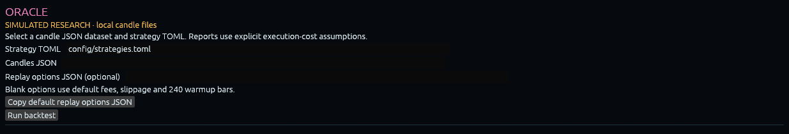
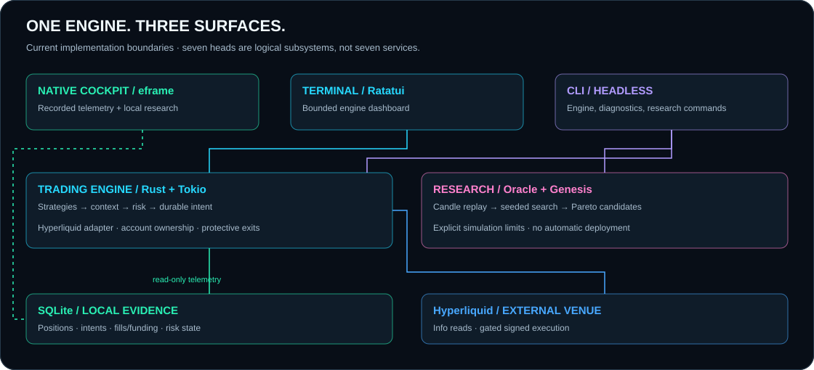

<div align="center">


# Quantitative intelligence, engineered around evidence.

**A native Rust trading engine and research command center for Hyperliquid.**<br>
Seven coordinated disciplines. Local persistence. Explicit uncertainty. Continuous evolution.

[](https://github.com/ShamelesAbyss/Hydra/releases/tag/v1.7.0-alpha.15) [](https://github.com/ShamelesAbyss/Hydra/actions/workflows/verify.yml?query=branch%3Amain) [](TEST_RESULTS.md) [](https://github.com/ShamelesAbyss/Hydra/blob/v1.7.0-alpha.15/Cargo.toml) [](LICENSE)

[](https://github.com/ShamelesAbyss/Hydra/releases/tag/v1.7.0-alpha.15) [](https://github.com/ShamelesAbyss/Hydra/actions/runs/45648387540/job/139325595722) [](https://github.com/ShamelesAbyss/Hydra/blob/v1.7.0-alpha.15/DEPENDENCY_AUDIT.md)

[**Download**](#download) · [**Cockpit**](#cockpit) · [**Seven heads**](#seven-heads) · [**Architecture**](#architecture) · [**Quick start**](#quick-start) · [**Readiness**](#readiness) · [**Roadmap**](#roadmap)

</div>

> [!IMPORTANT]
> **Engineering prerelease. Live-trading readiness is incomplete.** Exchange integration exists and live execution defaults disabled. Unresolved orders and unknown net settlement block new exposure. The published alpha.15 source passes 323 offline tests and a dependency audit with zero vulnerability entries and one maintenance warning. [Follow the verified main consolidation](https://github.com/ShamelesAbyss/Hydra/actions/runs/45581670769). Alpha.15 adds offline inspection of retained unsigned native IOC actions; financial settlement remains unverified. Prior releases remain available as historical checkpoints.

## Project Leviathan

[Contributing and branch policy](CONTRIBUTING.md) · [Current engineering handoff](PROJECT_STATUS.md)

Hydra brings market observation, strategy, adaptive context, risk, execution and research into one local quantitative workspace. Its identity is a seven-headed organism: each head has a distinct responsibility, while one engine owns the trading lifecycle and its durable evidence.

The design puts recoverable facts at the center. Intents are journaled before submission. Ambiguous acknowledgments stay ambiguous. Confirmed reductions preserve the exchange residual. Missing fees and funding remain unknown rather than becoming invented profit.

The native cockpit makes that evidence visible. Oracle replays historical candles; Genesis searches bounded parameter spaces using those simulations. Research runs independently of signing and proposes candidates for review.

### Know which Hydra you are looking at

| Track | What it contains | Where to go |
| :--- | :--- | :--- |
| **Authoritative main** | Authoritative Project Leviathan codebase and continuing development | [Browse main](https://github.com/ShamelesAbyss/Hydra/tree/main) |
| **Downloadable prerelease** | **1.7.0-alpha.15**, native cockpit/research, exact execution evidence and independent risk; 323 offline tests | [Release and checksums](https://github.com/ShamelesAbyss/Hydra/releases/tag/v1.7.0-alpha.15) |
| **Development on main** | Offline unsigned-action inspection; automatic recovery and financial settlement continue | [Authoritative main](https://github.com/ShamelesAbyss/Hydra/tree/main) |

Project Leviathan is Hydra. `main` contains the authoritative implementation and all continuing development. The [retired 1.6.2 archive](https://github.com/ShamelesAbyss/Hydra/tree/archive/dead-code-hydra-1.6.2) exists only for historical preservation and must not be used for live trading. Promotion to main does not establish stable-live readiness.

<a id="cockpit"></a>
## A native command center


*Actual local rendering of the alpha.9 native interface (interface unchanged in alpha.15). Empty local history, initialized offline: no account, exchange session, performance or trading activity is implied. Zero row counts and unavailable ledger tables are shown as observed. The documentation capture uses the real eframe application; no UI mockup or generated trading data is shown.*

The obsidian interface uses cyan, amber, violet, emerald, blue, rose and orchid to distinguish its seven heads. Recorded database changes drive telemetry pulses. Missing data is shown explicitly.

| Surface | Available today |
| :--- | :--- |
| **Native cockpit** | Read-only SQLite views, seven subsystem selectors, positions, execution evidence, risk state, source/schema diagnostics, refresh and pause |
| **Research workspaces** | Local candle/config/options inputs; one background job; actual Oracle equity reports and Genesis Pareto results; JSON export by copy |
| **Terminal dashboard** | Ratatui monitoring with bounded buffers, alongside headless operation |
| **CLI** | Engine commands, configuration checks, local initialization, read-only telemetry, historical research and ledger ingestion |

The cockpit runs independently of the trading engine. Closing its window sends no trading or stop command. First-launch history initialization is an explicit local action that preserves existing files. [Cockpit guide](https://github.com/ShamelesAbyss/Hydra/blob/v1.7.0-alpha.15/COCKPIT_GUIDE.md).

<a id="seven-heads"></a>
## Seven heads. Distinct responsibilities.

[Hunter](#hunter) · [Fang](#fang) · [Cognition](#cognition) · [Aegis](#aegis) · [Nexus](#nexus) · [Oracle](#oracle) · [Genesis](#genesis)

These are logical subsystem boundaries in an evolving Rust application. They are not seven independently deployed services, and a visible head is not a claim that every planned capability is complete.

<a id="hunter"></a>


**Observe the field.** Configured instruments, market snapshots, candle inputs and liquidity/spread checks supply the engine with market context. The cockpit displays recorded instrument activity.

**Next:** bounded market discovery, eligibility ranking, rotation and hysteresis. Autonomous whole-market selection is not implemented.

<a id="fang"></a>


**Turn context into a candidate.** Existing divergence, momentum/breakout and mean-reversion strategies produce signals and order intents. Oracle uses the existing strategy factory for deterministic candle evaluation.

**Next:** a shared deterministic live/research planner, explicit multi-strategy ownership and bounded grid planning. Grid parity, Auto-Unstuck and Martingale systems are not implemented.

<a id="cognition"></a>


**Remember with provenance.** Rolling expectancy, historical similarity, multi-timeframe regime context, adaptive strictness and bounded exploration exist. Unknown net outcomes from new reductions are excluded from learning and compounding.

**Development checkpoint:** immutable entry context and original risk distance persist atomically with positions, surviving restart and stop ratcheting. Legacy original risk remains explicitly unknown.

**Next:** authoritative fee/funding-adjusted outcomes and stronger historical provenance. Adaptive components are not a profitability claim.

<a id="aegis"></a>


**Protect the boundary.** Persistent equity peaks, drawdown latches, explicit audited rearm, immutable risk policies and transactional exposure reservations include pending exposure. Reservations do not expire automatically. Entry checks require fresh account evidence.

Only explicitly standard Hyperliquid account abstraction (`disabled`) is supported for valuation. Unknown, unified and portfolio-margin modes are refused; spot balances are not added to perp equity.

**New in alpha.6:** a scoped terminal-entry reconciliation bridge replaces only proven rejected/applied holds with observed exposure and retains immutable batch evidence. Ambiguous, orphan, reduced and closed cases stay held.

**Native pre-write foundation (alpha.14):** the engine supplies a native pre-write journal capability. Actual rounded price/size, asset, side/reduce-only, canonical cloid, IOC type and encoded unsigned action are retained before signing/network write. Persistence or scope failure prevents submission. No keys, signatures or signing nonce are stored or inferred. Alpha.15 adds `wire-history`: bounded offline inspection of the retained action, with field/MessagePack consistency checks and explicit unsigned-evidence limits. It does not prove sending, acceptance or settlement.

**Next:** fixed-point core-position facts, complete settlement and broader account models. Full protective automation is not certified.

<a id="nexus"></a>


**Commit facts before taking the next step.** Durable UUID/cloid intents precede submission; typed acknowledgments distinguish filled, resting, rejected and unresolved orders. Reductions require validated fills and matching remote residuals. Decimal fill/funding ingestion is account-scoped, deduplicated and bounded.

**Development checkpoint:** fresh pre-entry position ownership checks and recovery of the narrow crash window after durable position insertion, backed by a known receipt and matching account position. Unknown acknowledgments do not qualify.

**Development checkpoint:** the legacy SDK/ethers graph is replaced by a narrow mainnet IOC client using maintained secp256k1 signing primitives, ordered MessagePack and independently checked EIP-712 framing. Signed transport disables redirects/retries and bounds time and response size.

**Next:** broader cloid/fill replay and complete settlement reconciliation. Unknown net PnL continues to hold new exposure.

<a id="oracle"></a>


**Make the model explicit.** Deterministic single-instrument replay evaluates completed candles and enters at the next open. It applies fees/slippage on both legs, conservative stop-first handling and adverse stop-gap pricing. Reports retain options, date range, trades, equity, costs and drawdown.



*Oracle input workspace before loading a dataset. [Full unedited capture](docs/assets/oracle-workspace.png). No simulation result is implied.*

**Model limits:** full fills and fixed costs; no funding, order-book queues, partial fills, liquidation, adaptive learning, trailing/time-stop parity or portfolio margin. [Simulation contract](https://github.com/ShamelesAbyss/Hydra/blob/v1.7.0-alpha.15/BACKTESTING.md).

<a id="genesis"></a>


**Search, measure, propose.** Seeded CPU search evaluates momentum parameters through Oracle, using mutation, crossover, deduplication and Pareto filtering over return, drawdown and fee burden. Evaluation and work budgets are enforced. Reports preserve the algorithm identity and inputs.

**Next:** resumable checkpoints, out-of-sample evaluation, richer scenarios and constrained search. This is not NSGA-II, GPU optimization or automatic live deployment. [Optimization contract](https://github.com/ShamelesAbyss/Hydra/blob/v1.7.0-alpha.15/OPTIMIZATION.md).

<a id="architecture"></a>
## Anatomy of the engine



The native client reads consistent local snapshots; the headless engine owns signing and execution. Research jobs run in a bounded background worker so the interface can continue refreshing telemetry. SQLite stores durable execution, position, ledger and risk evidence.


| Invariant | Implemented behavior |
| :--- | :--- |
| **Authorization** | `ENABLE_LIVE_TRADING` is authoritative; `--live` cannot override false |
| **Durability** | Store intent before the exchange write; canonical UUID maps to cloid |
| **Uncertainty** | Preserve unresolved state; no blind resend or guessed fill |
| **Account identity** | Persistent database binding; same-user/host account ownership lock |
| **Reduction accounting** | Atomically record residual and gross evidence; net PnL remains unknown until proved |
| **Protective exits** | One instrument's close failure does not starve later instruments |
| **Restart context** | At `a941c68`, original risk/context survives; legacy unknowns are preserved |

[Architecture notes](https://github.com/ShamelesAbyss/Hydra/blob/v1.7.0-alpha.15/ARCHITECTURE.md) · [Hyperliquid boundary](https://github.com/ShamelesAbyss/Hydra/blob/v1.7.0-alpha.15/HYPERLIQUID_INTEGRATION.md) · [Risk authority](https://github.com/ShamelesAbyss/Hydra/blob/v1.7.0-alpha.15/RISK_MANAGEMENT.md)

<a id="download"></a>
## Download a verified checkpoint

| Artifact | Release | Contents / verification |
| :--- | :--- | :--- |
| [**Windows x86_64 portable ZIP**](https://github.com/ShamelesAbyss/Hydra/releases/download/v1.7.0-alpha.15/hydra-1.7.0-alpha.15-x86_64-pc-windows-msvc.zip) | **alpha.15** | `hydra.exe` + `hydra-cockpit.exe`, config and guides; locally built and smoke checked |
| [**Source ZIP**](https://github.com/ShamelesAbyss/Hydra/releases/download/v1.7.0-alpha.15/hydra-1.7.0-alpha.15-source.zip) | **alpha.15** | Exact release source export; excludes inherited legacy binaries |
| [**SHA-256 manifest**](https://github.com/ShamelesAbyss/Hydra/releases/download/v1.7.0-alpha.15/hydra-1.7.0-alpha.15-SHA256SUMS.txt) | **alpha.15** | Verify the archive hash before extraction |
| [**Linux x86_64 headless tar.gz**](https://github.com/ShamelesAbyss/Hydra/releases/download/v1.7.0-alpha.15/hydra-1.7.0-alpha.15-x86_64-unknown-linux-gnu.tar.gz) | **alpha.15** | Verified CI executable plus exact-tag guides/assets; [Linux SHA-256 manifest](https://github.com/ShamelesAbyss/Hydra/releases/download/v1.7.0-alpha.15/hydra-1.7.0-alpha.15-linux-SHA256SUMS.txt) |

**Dependency fix delivery:** alpha.15 retains the remediated graph. Older alpha.4 assets retain their original dependencies and are preserved as historical downloads.

Windows executables are **unsigned**. There is no installer or code-signing claim. macOS and Linux native-desktop distribution are not currently verified. Release artifacts and source history are retained; newer branch changes are not silently substituted into a published ZIP.

<a id="quick-start"></a>
## Start locally

### Windows portable

Verify the downloaded ZIP against the release manifest, then extract it into a writable folder. Open PowerShell in that folder and keep `config/` beside the executable. Run `Get-FileHash` against the ZIP at its download location.

```powershell
.\hydra.exe --version
.\hydra.exe --help
.\hydra.exe --no-banner config-check
.\hydra-cockpit.exe
```

For a local empty history and read-only snapshot, without credentials or exchange access:

```powershell
.\hydra.exe init-history --db data/hydra.db
.\hydra.exe telemetry --db data/hydra.db --limit 100
.\hydra-cockpit.exe --db data/hydra.db
```

`init-history` refuses to overwrite an existing file. Existing history can be opened directly in the cockpit.

### Linux headless

From the download directory, verify the Linux manifest and extract into an empty folder:

```sh
sha256sum --check hydra-1.7.0-alpha.15-linux-SHA256SUMS.txt
mkdir hydra-alpha14
tar -xzf hydra-1.7.0-alpha.15-x86_64-unknown-linux-gnu.tar.gz -C hydra-alpha14
cd hydra-alpha14
./hydra --version
./hydra --no-banner config-check
```

The GNU/Linux executable is verified on the GitHub Ubuntu runner. The Linux archive contains the CLI, guides and artwork; it does not include a native graphical executable.

### Build Project Leviathan from main

Use Rust **1.94 or newer** for the tested toolchain. Native desktop requires the platform's graphics and build dependencies; Windows MSVC is the verified desktop target.

```sh
git clone --branch main https://github.com/ShamelesAbyss/Hydra.git
cd Hydra
cargo build --locked --release --bin hydra
cargo build --locked --release --features desktop --bin hydra-cockpit
cargo test --locked --features desktop --all-targets
cargo fmt --check
cargo clippy --locked --features desktop --all-targets
```

For exactly the packaged release, run `git checkout v1.7.0-alpha.15` before building. The experimental branch continues to evolve.

### Configuration

Strategy TOML lives in [`config/strategies.toml`](https://github.com/ShamelesAbyss/Hydra/blob/v1.7.0-alpha.15/config/strategies.toml). Environment settings are documented in [`.env.example`](https://github.com/ShamelesAbyss/Hydra/blob/v1.7.0-alpha.15/.env.example). Keep secrets outside version control.

```dotenv
ENABLE_LIVE_TRADING=false
HYPERLIQUID_PRIVATE_KEY=
HYPERLIQUID_ACCOUNT_ADDRESS=
DB_PATH=./data/hydra.db
LOG_LEVEL=info
```

No credentials are required for local history, telemetry or research. Dry-run engine operation can read public market data; it is not a paper exchange simulator. With `ENABLE_LIVE_TRADING=false`, these commands do not submit orders:

```powershell
.\hydra.exe --config config/strategies.toml run --symbols ETH,BTC
.\hydra.exe --config config/strategies.toml run --symbols ETH,BTC --no-tui
```

Inspect retained local lifecycle observations without exchange access:

```powershell
.\hydra.exe status-history --db data/hydra.db --intent "<canonical-intent-uuid>" --limit 20
.\hydra.exe wire-history --db data/hydra.db --intent "<canonical-intent-uuid>"
```

Replace the placeholder with a known canonical intent UUID. These commands need an existing bound history. It reports local records, unavailable tables and capping explicitly; it does not query the venue or prove complete exchange history.

Account-bound commands require explicit identity and additional checks. Read [the integration guide](https://github.com/ShamelesAbyss/Hydra/blob/v1.7.0-alpha.15/HYPERLIQUID_INTEGRATION.md) before considering account access. This README does not establish live readiness.

### Research without an engine session

```powershell
.\hydra.exe --config config/strategies.toml backtest --candles historical-candles.json
.\hydra.exe --config config/strategies.toml optimize --candles historical-candles.json
```

Candle input is an ordered JSON array containing RFC3339 `ts`, `open`, `high`, `low`, `close` and `volume`. Inputs are bounded to 32 MiB. Use sufficient warmup history; the default replay warmup is 240 bars. Add `--options path/to/options.json` for explicit settings. The GUI provides default-options JSON for copying. [Oracle guide](https://github.com/ShamelesAbyss/Hydra/blob/v1.7.0-alpha.15/BACKTESTING.md) · [Genesis guide](https://github.com/ShamelesAbyss/Hydra/blob/v1.7.0-alpha.15/OPTIMIZATION.md).

<a id="readiness"></a>
## Verification, security and live readiness

| Evidence | Verified state |
| :--- | :--- |
| **Local test suite** | Main: **323 offline desktop-feature tests**; published alpha.15: 323. [Current test evidence](TEST_RESULTS.md) |
| **GitHub builds** | Alpha.15 [passed all four jobs for the exact tagged source](https://github.com/ShamelesAbyss/Hydra/actions/runs/45648387540): Linux, Windows, native desktop and audit |
| **Formatting / Clippy** | Passed locally; Clippy retains style warnings |
| **Signing references** | Eight offline cross-language fixtures against published official Python SDK constants |
| **Dependency audit** | **Source checkpoint passes**: 0 vulnerability entries, 1 Chrono maintenance warning; no advisory ignores. Alpha.7 retains the remediated dependency graph |
| **Formal security scan** | No successful canonical plugin scan is claimed; the plugin could not resolve the Windows worktree |
| **Live verification** | No real exchange orders, credential probes or transfers were used during this development verification |
| **Profitability / stable operation** | Not established; no return, benchmark, win-rate or live-safety claim |

Build success and security-audit success are separate checks. The workflow badge above shows the current aggregate result. The former failing audit remains remediated; older downloads remain unchanged. A passing test suite is evidence about tested contracts, not a trading recommendation.

Open readiness work includes complete trade settlement, broader recovery, risk-reservation reconciliation, legacy learning provenance and Chrono modernization. Legacy history is preserved without retroactive accuracy certification. [Test evidence](https://github.com/ShamelesAbyss/Hydra/blob/v1.7.0-alpha.15/TEST_RESULTS.md) · [Dependency inventory](https://github.com/ShamelesAbyss/Hydra/blob/v1.7.0-alpha.15/DEPENDENCY_AUDIT.md) · [Engineering audit](https://github.com/ShamelesAbyss/Hydra/blob/v1.7.0-alpha.15/HYDRA_AUDIT.md).

<a id="roadmap"></a>
## Continuous evolution

| Stage | State | Delivery boundary |
| :--- | :--- | :--- |
| **01 / Execution foundations** | Implemented, incomplete certification | Durable intents, typed receipts, residual confirmation and uncertainty gates |
| **02 / Account evidence & Aegis** | Implemented foundation | Decimal ledger, account binding, ownership, persistent risk reservations/breakers |
| **03 / Native command center** | Implemented in alpha.3+ | Read-only telemetry, first-launch local setup, seven workspaces |
| **04 / Oracle & Genesis** | Implemented in alpha.4 | Deterministic candle replay and bounded CPU parameter search |
| **05 / Recovery & settlement** | Active | Original entry context and narrow scoped reservation proof landed; full cloid/fill replay, net accounting and orphan atomicity remain |
| **06 / Secure execution modernization** | Implemented source checkpoint | Legacy affected dependency paths removed; signing conformance preserved; Chrono maintenance work remains |
| **07 / Shared planning & discovery** | Planned | Hunter ranking/rotation, deterministic Fang planner, explicit strategy ownership |
| **08 / Research depth** | Planned | Out-of-sample testing, resumable optimization, multi-scenario/portfolio models |
| **09 / Operational certification** | Planned | Verified complete recovery, financial/security review and distribution hardening |

Unimplemented capabilities remain visible in the [capability ledger](https://github.com/ShamelesAbyss/Hydra/blob/v1.7.0-alpha.15/FEATURE_PARITY.md) and [implementation plan](https://github.com/ShamelesAbyss/Hydra/blob/v1.7.0-alpha.15/IMPLEMENTATION_PLAN.md). GPU research, NSGA-II and automatic candidate deployment are not part of the current executable contract.

## Engineering atlas

| Build and operate | Understand and extend |
| :--- | :--- |
| [Project status](https://github.com/ShamelesAbyss/Hydra/blob/v1.7.0-alpha.15/PROJECT_STATUS.md) | [Architecture](https://github.com/ShamelesAbyss/Hydra/blob/v1.7.0-alpha.15/ARCHITECTURE.md) |
| [Cockpit guide](https://github.com/ShamelesAbyss/Hydra/blob/v1.7.0-alpha.15/COCKPIT_GUIDE.md) | [Implementation plan](https://github.com/ShamelesAbyss/Hydra/blob/v1.7.0-alpha.15/IMPLEMENTATION_PLAN.md) |
| [Hyperliquid integration](https://github.com/ShamelesAbyss/Hydra/blob/v1.7.0-alpha.15/HYPERLIQUID_INTEGRATION.md) | [Capability ledger](https://github.com/ShamelesAbyss/Hydra/blob/v1.7.0-alpha.15/FEATURE_PARITY.md) |
| [Risk management](https://github.com/ShamelesAbyss/Hydra/blob/v1.7.0-alpha.15/RISK_MANAGEMENT.md) | [Passivbot research](https://github.com/ShamelesAbyss/Hydra/blob/v1.7.0-alpha.15/PASSIVBOT_AUDIT.md) |
| [Test results](https://github.com/ShamelesAbyss/Hydra/blob/v1.7.0-alpha.15/TEST_RESULTS.md) | [Oracle simulation](https://github.com/ShamelesAbyss/Hydra/blob/v1.7.0-alpha.15/BACKTESTING.md) |
| [Dependency audit](https://github.com/ShamelesAbyss/Hydra/blob/v1.7.0-alpha.15/DEPENDENCY_AUDIT.md) | [Genesis optimization](https://github.com/ShamelesAbyss/Hydra/blob/v1.7.0-alpha.15/OPTIMIZATION.md) |
| [Release notes](https://github.com/ShamelesAbyss/Hydra/blob/v1.7.0-alpha.15/RELEASE_NOTES.md) | [MIT license](LICENSE) |

Supporting documents are linked to the inspected development checkpoint so they resolve from the default branch. The architecture, capability ledger and verification evidence have been refreshed from the inspected implementation. Historical milestone records remain explicitly dated.

---

<div align="center">

**SEVEN HEADS. ONE ENGINE. CONTINUOUS EVOLUTION.**

Native computation · Durable evidence · Deliberate execution

[Releases](https://github.com/ShamelesAbyss/Hydra/releases) · [Main](https://github.com/ShamelesAbyss/Hydra/tree/main) · [Issues](https://github.com/ShamelesAbyss/Hydra/issues)

</div>
