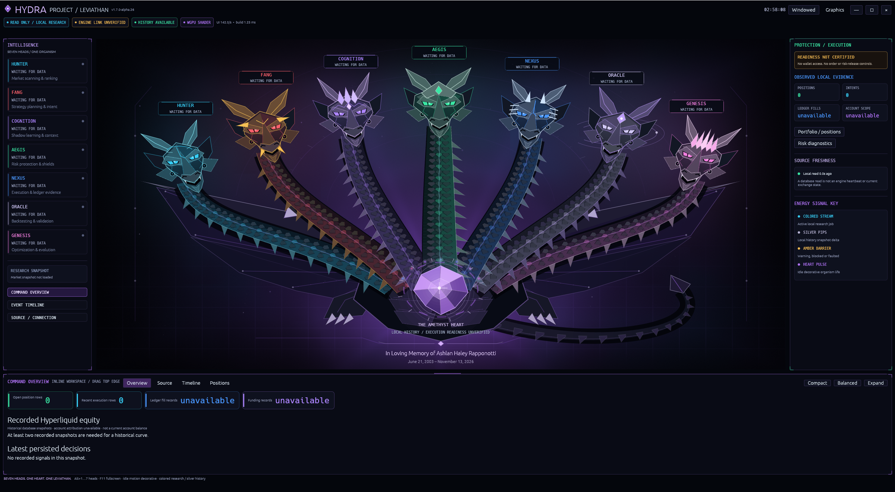
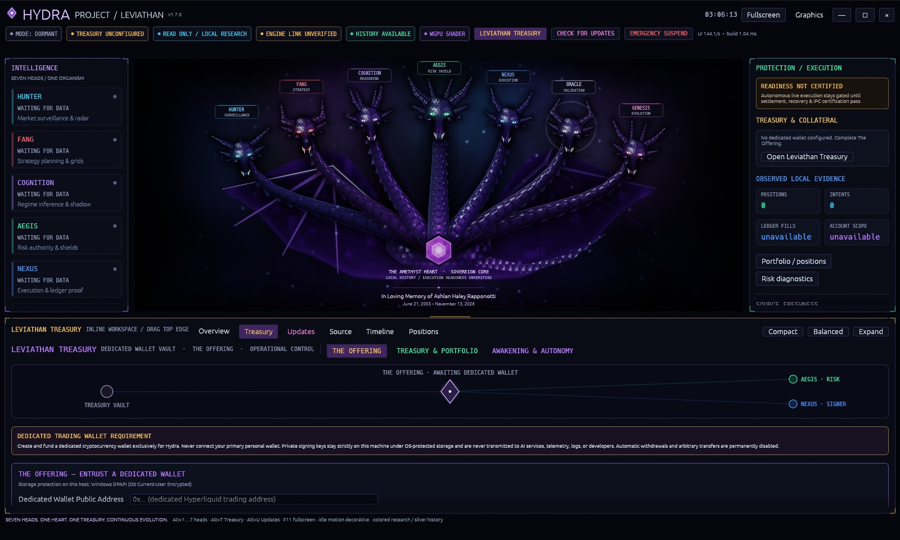

# HYDRA — Project Leviathan v1.7.0-alpha.27: Standalone Double-Click Windows Executable & Automated Verified Releases

> **Engineering prerelease.** Trading remains disabled by default (`DORMANT` mode; `ENABLE_LIVE_TRADING=false`). Live unattended `AWAKENED` operation stays strictly gated until authoritative financial settlement, complete recovery, authenticated control IPC, and watchdog certification pass.

## Direct Download (Windows x64 — Double-Click Ready)

- **[DOWNLOAD HYDRA FOR WINDOWS — `HYDRA-Leviathan-Windows-x64.exe`](https://github.com/ShamelesAbyss/Hydra/releases/download/v1.7.0-alpha.27/HYDRA-Leviathan-Windows-x64.exe)** — Standalone native WGPU graphical command center. Download and double-click to launch directly on Windows 10/11 (no Rust, Python, PowerShell, CLI flags, repository clone, or ZIP extraction required).
- **[Windows Portable ZIP (Advanced Users)](https://github.com/ShamelesAbyss/Hydra/releases/download/v1.7.0-alpha.27/hydra-1.7.0-alpha.27-x86_64-pc-windows-msvc.zip)** — Includes `HYDRA-Leviathan-Windows-x64.exe`, `hydra-cockpit.exe`, headless/terminal `hydra.exe`, `config/`, guides, assets, and memorial rules.
- **[Linux x86_64 Headless CLI (`tar.gz`)](https://github.com/ShamelesAbyss/Hydra/releases/download/v1.7.0-alpha.27/hydra-1.7.0-alpha.27-x86_64-unknown-linux-gnu.tar.gz)**
- **[SHA-256 Checksums (`hydra-1.7.0-alpha.27-SHA256SUMS.txt`)](https://github.com/ShamelesAbyss/Hydra/releases/download/v1.7.0-alpha.27/hydra-1.7.0-alpha.27-SHA256SUMS.txt)**

## Application Screenshots





## Installation & Launch

### Windows (Standard Users — Standalone Executable)
1. Download **`HYDRA-Leviathan-Windows-x64.exe`**.
2. *(Optional)* Verify its SHA-256 checksum against `hydra-1.7.0-alpha.27-SHA256SUMS.txt`:
   ```powershell
   Get-FileHash .\HYDRA-Leviathan-Windows-x64.exe -Algorithm SHA256
   ```
3. **Double-click `HYDRA-Leviathan-Windows-x64.exe`** (Windows SmartScreen may note the binary is unsigned).
4. On a clean Windows profile with no prior database, config, or wallet, Hydra safely initializes an empty dormant local history under `%LOCALAPPDATA%\Hydra\data\hydra.db` and launches directly into the living seven-headed Leviathan cockpit with trading disabled.
5. *(Optional compatibility flags)* Run from terminal with `--renderer glow` for OpenGL fallback, `--renderer software` for WGPU CPU fallback, `--fullscreen`, or `--treasury` to open directly to **LEVIATHAN TREASURY / THE OFFERING**.

### Linux Headless CLI
```sh
sha256sum --check hydra-1.7.0-alpha.27-linux-SHA256SUMS.txt
mkdir hydra-alpha27 && tar -xzf hydra-1.7.0-alpha.27-x86_64-unknown-linux-gnu.tar.gz -C hydra-alpha27
cd hydra-alpha27 && ./hydra --version && ./hydra --no-banner config-check
```

## Major New Functionality & Fixes in v1.7.0-alpha.27

### Distribution & Startup Reliability Fixes
- **Standalone Windows Graphical Executable (`HYDRA-Leviathan-Windows-x64.exe`):** Fixed the packaging gap where standard Windows downloads only shipped the headless CLI `hydra.exe`. Every release now publishes `HYDRA-Leviathan-Windows-x64.exe` directly as the primary download alongside advanced portable ZIP, Linux, and source archives.
- **Clean-Profile Zero-Friction Startup (`src/startup_diagnostics.rs`, `src/bin/hydra-cockpit.rs`):** Resolves OS-native writable application directories (`%LOCALAPPDATA%\Hydra\data\`, `logs\`, `treasury\`) automatically when launched without CLI arguments, initializing an empty dormant local database on first launch so clean profiles never hit missing-directory or read-only-folder errors.
- **Crash-Proof Renderer Fallback & Visible Error Dialog:** Wraps each renderer startup attempt (`WGPU` → `Glow`) in `catch_unwind` so even a GPU driver panic cleanly falls back to OpenGL. Installs a global panic hook that writes readable local crash diagnostics to `%LOCALAPPDATA%\Hydra\logs\crash-*.txt` and shows a native Windows error dialog (`MessageBoxW`) instead of silently terminating.
- **Monitor-Safe Default Geometry:** Opens centered at `1600 × 960` with the wide 3-column command layout enabled at `>= 1480 px`, fitting both 1080p (including DPI scaling) and 1440p/4K monitors immediately without clipping off-screen.
- **Dedicated Automated Release Workflow (`.github/workflows/release.yml`):** Validates tag-to-`Cargo.toml` version match, verifies permanent memorial preservation, runs formatting, Clippy, desktop-wgpu + headless tests and dependency audit, smoke-tests binaries, publishes the non-draft GitHub Release with retry protection, and verifies public unauthenticated HTTP 200 downloads + exact SHA-256 digest post-publish.

### Graphical, Treasury & Engineering Highlights Included
- **Living Seven-Headed WGPU Sanctuary:** Custom WGSL volumetric lighting shader (`src/leviathan_shader.rs`) with Glow fallback, sweeping cybernetic dragon wings, physiological breathing, smooth blinking, serpentine neck sway, seven distinct dragon phenotypes, dual-peak Amethyst Heart with 7 pylon conduits, and obsidian-glass command rails.
- **LEVIATHAN TREASURY & THE OFFERING:** Dedicated wallet vault with Windows DPAPI (`CryptProtectData`) / Unix `0700`/`0600` protection, zeroizing secret buffers, masked UI inputs, verbatim capital-loss acknowledgment, read-only public-address Hyperliquid verification, 12-metric truthful portfolio surface (separating external transfers from trading profits), six operational modes (`DORMANT`..`SUSPENDED`), and one-click `EMERGENCY SUSPEND`.

## Verification, Security & Known Limitations
- **Offline tests:** **451 passing offline tests** (`cargo test --locked --features desktop-wgpu --all-targets`), plus Linux/Windows headless tests, `cargo fmt --check`, `cargo clippy --locked --all-targets`, and `cargo audit` (0 vulnerability entries, 1 existing Chrono maintenance warning).
- **Security:** Private signing keys remain strictly local under OS protection and never touch logs, telemetry, or network calls. No automatic withdrawal or arbitrary asset transfer exists.
- **Trading readiness & known limits:** Engineering prerelease only; Windows executables are unsigned. Unattended `AWAKENED` live operation remains locked pending complete round-trip net fee/funding settlement, external deposit/withdrawal ledger reconciliation, full stream/restart recovery, authenticated control IPC, and watchdog supervision (tracked in `MILESTONE_MATRIX.md`).

---

### In Loving Memory of Ashlan Haley Rapponotti

*June 21, 2003 – November 13, 2026*

For the beautiful woman who listened to my passions, believed in me, and made my world a happier place simply by being part of it.

Every creation, every discovery, and every milestone reached carries a piece of my heart dedicated to you.

**Forever loved. Forever missed. Forever remembered.** 💜
